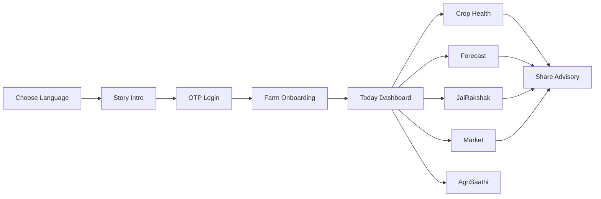
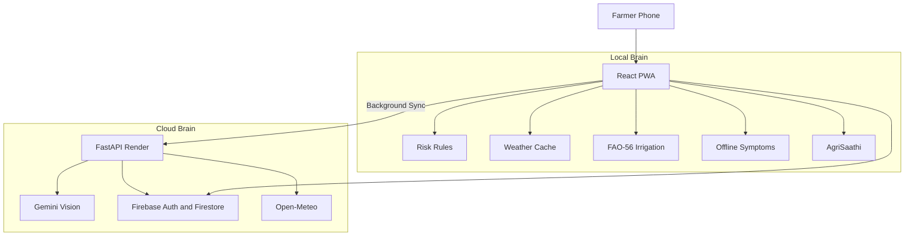
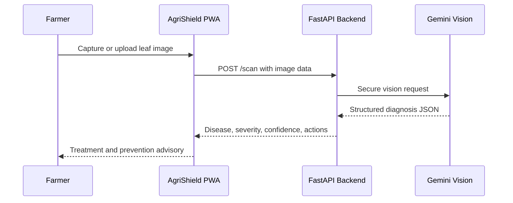
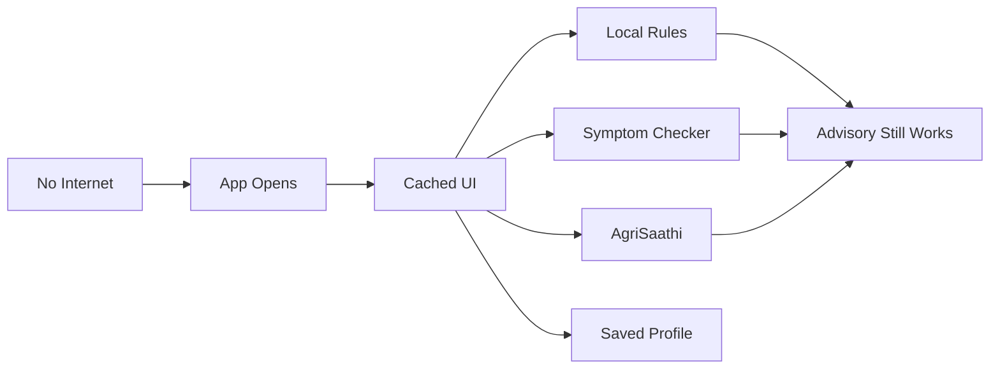

<div align="center">

# 🛡️ AgriShield 365 🌾

### **Every Farmer, Every Season, Protected**

**A farmer-first crop-health and risk-intelligence platform for early detection, forecasting and management of crop diseases, pest infestations, irrigation stress, weather disasters and mandi uncertainty.**

<br />

[](https://agrishield365.web.app)
[](https://agrishield365-api.onrender.com/health)
[](#offline-first-design)

<br />


<br />

**Team:** RAVEN ROOTS  
**Theme:** Agriculture, FoodTech & Rural Development  
**Category:** Software  
**Problem Statement:** Early detection and management of crop diseases and pest infestations  
**Organization:** Government of Maharashtra  
**Department:** Maharashtra State Innovation Society, Department of Skills, Employment, Entrepreneurship and Innovation

</div>

---

## 📌 Table of Contents

- [About the Project](#-about-the-project)
- [Why AgriShield 365?](#-why-agrishield-365)
- [Problem Statement](#-problem-statement)
- [Expected Outcome vs. Our Implementation](#-expected-outcome-vs-our-implementation)
- [Key Features](#-key-features)
- [Farmer Journey](#-farmer-journey)
- [Crops and Regions](#-crops-and-regions)
- [System Architecture](#-system-architecture)
- [Gemini Integration](#-gemini-integration)
- [Offline-First Design](#-offline-first-design)
- [Core Intelligence Modules](#-core-intelligence-modules)
- [Tech Stack](#-tech-stack)
- [Repository Structure](#-repository-structure)
- [Getting Started](#-getting-started)
- [Environment Variables](#-environment-variables)
- [API Endpoints](#-api-endpoints)
- [Demo Guide](#-demo-guide)
- [Data Sources and Scientific Basis](#-data-sources-and-scientific-basis)
- [Impact](#-impact)
- [Roadmap](#-roadmap)
- [Team](#-team)
- [License](#-license)

---

## 🌾 About the Project

**AgriShield 365** is a multilingual, local-first crop-health platform designed to help farmers and extension workers detect, forecast and manage crop diseases and pest infestations before the damage spreads.

The project combines:

- **Image-based crop symptom identification** using Gemini Vision through a secure backend.
- **Weather-based pest and disease risk forecasting** using crop-specific thresholds.
- **Offline symptom checking** for low-connectivity rural conditions.
- **Scientific irrigation planning** through FAO-56 crop coefficient logic.
- **Mandi price awareness** to help farmers understand cost, selling price and margin.
- **Multilingual advisories** in English, Hindi, Bengali and Marathi.
- **Installable PWA experience** so the app can run from a farmer's phone like a native app.

The central idea is simple:

> Farmers should not discover disease only after the crop is already damaged. AgriShield warns early, explains clearly, and recommends practical next steps.

---

## 🚨 Why AgriShield 365?

Farmers often recognize crop diseases and pest infestations only after visible damage has already spread across the field. By that time, the cost of recovery rises sharply and yield loss becomes difficult to prevent.

Several real-world gaps make this problem worse:

- **Delayed detection:** symptoms are noticed late, especially when the farmer does not know which early signs matter.
- **Limited expert access:** extension workers often cover large geographic areas and cannot visit every farm immediately.
- **Fragmented information:** weather, crop stage, soil condition, irrigation practice and local pest history are rarely combined into one farm-level alert.
- **Incorrect pesticide use:** misdiagnosis may lead to excessive, delayed or inappropriate chemical application.
- **Climate instability:** unseasonal rain, humidity spikes, heat waves and waterlogging create disease-friendly conditions.
- **Language barriers:** advisories are often not available in the farmer's own language.
- **Connectivity barriers:** many rural areas cannot rely on continuous internet access.

AgriShield 365 addresses these gaps by bringing **early warning, diagnosis support, advisory logic and follow-up guidance** into one phone-based system.

---

## 🧩 Problem Statement

### Official Problem Area

**Early detection and management of crop diseases and pest infestations**

### Problem Description

Farmers often recognize crop diseases or pest infestations only after visible damage has spread. Extension staff may cover large areas, while laboratory diagnosis and expert advice may not be immediately available. Weather, crop stage, variety, soil condition and local pest history influence risk, but these inputs are rarely combined into actionable farm-level alerts.

Incorrect diagnosis may lead to delayed treatment, excessive or inappropriate pesticide use, increased cultivation cost, residue concerns and yield loss. The challenge is to provide timely, reliable and locally relevant detection, forecasting and management support.

### Expected Solution / Outcome

A farmer- and extension-worker-friendly crop-health system that supports:

- image-based symptom identification,
- pest-trap or sensor inputs,
- weather-based risk forecasting,
- geospatial hotspot mapping,
- expert validation,
- multilingual advisories,
- integrated pest and disease management recommendations,
- safe input usage,
- referral to extension workers or laboratories,
- follow-up monitoring,
- learning from field confirmations,
- dashboards for agriculture officials.

Expected outcomes include earlier detection, reduced crop loss, more targeted pesticide use, faster extension response, improved surveillance coverage and better planning of preventive interventions.

---

## ✅ Expected Outcome vs. Our Implementation

| Expected Capability | AgriShield 365 Implementation |
| --- | --- |
| Image-based symptom identification | Gemini Vision powered AI leaf scan through FastAPI backend |
| Pest/disease risk forecasting | 8 crop-specific threat rules using temperature, humidity, rainfall and crop stage |
| Multilingual advisories | English, हिन्दी, বাংলা, मराठी across UI, alerts, story and advice |
| Farmer-friendly interface | Mobile-first PWA, guided story onboarding, large cards, clear icons and voice support |
| Extension-worker support | Structured advisories, shareable alerts and future dashboard pathway |
| Safe management recommendations | Treatment and prevention steps, offline symptom checker and explainable alert reasons |
| Weather-based early warnings | 7-day forecast, 24-hour view, heavy rain, flood, dry spell and heat risk alerts |
| Irrigation planning | FAO-56 based JalRakshak module with litres per acre and rain-skip logic |
| Geospatial hotspot mapping | Future KhetiScan roadmap for NDVI/NDWI based district surveillance |
| Follow-up monitoring | Advisory history and profile-level crop/farm state |
| Local relevance | Focus crops and regions selected around West Bengal and Maharashtra farming contexts |
| Offline resilience | Local rule engine, cached weather fallback, offline symptom checker and installable PWA |

---

## ✨ Key Features

### 🧠 1. Local Pest and Disease Risk Engine

AgriShield's first brain runs directly inside the browser. It checks crop type, growth stage, rainfall, temperature, humidity, soil type and irrigation method to generate early warnings.

It supports **8 threat models** across paddy, potato and cotton:

- Rice blast
- Sheath blight
- Bacterial blight
- Late blight
- Early blight
- Fusarium wilt
- Bollworm
- Whitefly

Each alert is explainable through simple farmer-facing reasoning such as:

> “High humidity and repeated rain during a vulnerable crop stage increase sheath blight risk.”

---

### 📷 2. Crop Health: AI Leaf Scan + Offline Symptom Checker

The **Crop Health** section contains two diagnosis paths:

#### AI Leaf Scan

The farmer uploads or captures a leaf image. The backend sends it securely to Gemini Vision, which returns:

- whether the image is a valid crop/leaf image,
- likely disease or pest damage,
- affected crop,
- severity,
- confidence,
- causes,
- treatment steps,
- prevention steps.

#### Offline Symptom Checker

If the internet is unavailable or the AI provider is not reachable, the farmer can still diagnose symptoms by tapping visible signs such as spots, wilting, yellowing, pest damage or lesions.

This works fully offline and is ideal for real rural conditions.

---

### 💧 3. JalRakshak Smart Irrigation

JalRakshak calculates how much water the crop actually needs instead of relying on guesswork.

It considers:

- crop type,
- crop stage,
- FAO-56 Kc coefficient,
- rainfall,
- ET₀ evapotranspiration,
- soil type,
- irrigation method,
- farm area.

It then gives:

- irrigation needed in **millimetres**,
- water needed in **litres per acre**,
- whether irrigation should be skipped due to rain,
- best irrigation timing,
- 4-day irrigation plan.

---

### 🌦️ 4. Forecast and Disaster Alerts

The app uses Open-Meteo weather data to provide:

- 7-day forecast,
- temperature trend,
- humidity trend,
- rainfall probability,
- heavy rain warnings,
- flood risk warnings,
- dry spell alerts,
- heat risk alerts.

The goal is to give the farmer a **3–5 day lead time** before weather-driven crop stress becomes severe.

---

### 📈 5. Market Price Awareness

The Market screen shows:

- crop-wise mandi price,
- cost of production,
- margin per quintal,
- trend chart,
- sell/hold style guidance,
- “Updated today” source label.

This helps farmers connect crop protection with income protection.

---

### 🤖 6. AgriSaathi Offline Farm Assistant

**AgriSaathi** is the floating assistant inside the app. It answers questions using the app's own local data rather than depending on a large language model.

It can respond to farmer questions about:

- weather,
- pest risk,
- irrigation,
- mandi price,
- crop health,
- next best action.

It supports:

- tap chips,
- typed questions,
- voice input,
- read-aloud responses,
- offline operation.

---

### 🌐 7. Four-Language Farmer Experience

AgriShield supports:

- English
- हिन्दी
- বাংলা
- मराठी

The farmer's language choice affects:

- story screens,
- navigation,
- warnings,
- advisory cards,
- symptom checker,
- assistant replies,
- read-aloud text.

---

### 📲 8. Shareable Advisories

Farmers can share advisory text with others through phone-native sharing options. This is useful because one connected farmer can alert an entire village group.

---

### 🔐 9. OTP Login

The app uses Firebase phone authentication. For demo and testing, whitelisted phone numbers can use:

```text
OTP: 123456
```

---

### 📶 10. Installable Offline PWA

AgriShield can be installed to the home screen and launched like a native app. The service worker precaches the core app shell so farmers can continue using key features even with poor connectivity.

---

## 👨‍🌾 Farmer Journey

AgriShield is designed as a complete farmer journey, not just a dashboard.



### Journey Flow

1. Farmer opens the app.
2. Chooses their language.
3. Watches a short story explaining why early warnings matter.
4. Logs in using phone OTP.
5. Adds farm location, crop, sowing date, area, soil and irrigation method.
6. Sees today's risk status.
7. Checks disease/pest alerts, forecast, irrigation and market guidance.
8. Uses AI scan or offline symptom checker for crop-health doubts.
9. Shares the advisory with other farmers or extension workers.

---

## 🌱 Crops and Regions

AgriShield 365 focuses on three high-impact crop contexts:

| Crop | Primary Region | Why It Matters |
| --- | --- | --- |
| 🌾 Aman Paddy | West Bengal | Highly sensitive to rainfall, humidity, bacterial blight, blast and sheath blight |
| 🥔 Potato | West Bengal | Vulnerable to late blight and early blight under cool-humid conditions |
| 🏵️ Cotton | Vidarbha, Maharashtra | Major pest-pressure crop affected by bollworm, whitefly and wilt risks |

---

## 🏗️ System Architecture

AgriShield uses a **two-brain architecture**.

- The **local brain** runs inside the farmer's phone and never blocks the UI.
- The **cloud brain** handles Gemini scan, optional persistence and backend validation.



### Design Principle

> The farmer should never wait for the cloud to know whether the crop is at risk.

If Render is asleep, Gemini quota is unavailable, SMS is delayed, or internet is weak, the app still provides local advisories and offline diagnosis.

---

## 🔮 Gemini Integration

Gemini is integrated as the visual crop-health intelligence layer.

### How it works



### Gemini's Role

Gemini helps AgriShield identify visible crop symptoms from leaf images and convert them into farmer-friendly guidance. It acts as a **first-response crop-health assistant**, especially when expert diagnosis is not immediately available.

The backend prompt asks Gemini to return structured JSON with:

```json
{
  "isLeaf": true,
  "crop": "paddy",
  "disease": "sheath blight",
  "severity": "medium",
  "confidence": 82,
  "summary": "Likely fungal infection under humid conditions.",
  "causes": ["High humidity", "Dense canopy", "Recent rain"],
  "treatment": ["Remove heavily infected leaves", "Avoid overhead irrigation"],
  "prevention": ["Improve spacing", "Monitor after rainfall"]
}
```

### Reliability Choice

Gemini improves the system, but the system does not fully depend on Gemini. The offline symptom checker and weather-risk engine continue working even without AI availability.

---

## 📶 Offline-First Design

AgriShield is built for real villages, not perfect lab conditions.

Offline-first decisions include:

- local risk computation in the browser,
- deterministic weather fallback,
- symptom checker without server calls,
- AgriSaathi local assistant,
- Web Speech API for device-based read-aloud,
- Web Audio API story music without audio files,
- PWA install support,
- background-only cloud sync.



---

## 🧪 Core Intelligence Modules

### 1. Crop Stage Model

The app estimates crop stage from sowing date and crop duration. Each stage carries a crop coefficient and vulnerability status.

Examples:

| Crop | Stages Considered |
| --- | --- |
| Paddy | Establishment, tillering, panicle/flowering, maturity |
| Potato | Emergence, vegetative, tuber bulking, maturity |
| Cotton | Seedling, square/flowering, boll development, maturity |

---

### 2. Disease and Pest Risk Rules

Risk rules consider:

- maximum temperature,
- minimum temperature,
- humidity,
- rainfall,
- dry spell,
- waterlogging,
- crop stage vulnerability,
- multi-day weather window.

Threats are ranked as:

- **Critical**
- **Warning**
- **Info**

---

### 3. Irrigation Model

JalRakshak uses the FAO-56 principle:

```text
Crop Water Need = Kc × ET₀
```

Then adjusts using:

```text
Net Need = max(0, Crop Water Need - Rainfall)
Adjusted Need = Net Need / Irrigation Efficiency × Soil Factor
```

The final result is shown as:

```text
mm required
litres per acre
litres total for farm area
skip / irrigate recommendation
```

---

### 4. Market Model

The market panel uses crop-wise local mandi values to estimate farmer margin:

```text
Margin = Selling Price - Cost of Production
```

Displayed unit:

```text
₹ / quintal
```

---

## 🧰 Tech Stack

### Frontend

| Technology | Purpose |
| --- | --- |
| React 19 | UI and app state |
| Vite | Build system and dev server |
| Tailwind CSS 4 | Styling |
| Framer Motion | Smooth transitions and guided story |
| Recharts | Forecast and market charts |
| React Leaflet | Farm map and location selection |
| Firebase Web SDK | Phone auth and client-side Firebase integration |
| Vite PWA / Workbox | Offline installable app |
| Web Speech API | Text-to-speech and voice interaction |
| Web Audio API | Generated story background sound |

### Backend

| Technology | Purpose |
| --- | --- |
| FastAPI | Cloud API service |
| Uvicorn | ASGI server |
| Pydantic | Request validation |
| Requests | External API calls |
| Firebase Admin | Optional server-side persistence |
| Gemini API | Vision-based crop diagnosis |
| Render | Backend deployment |

### Data and APIs

| Source | Use |
| --- | --- |
| Open-Meteo | Weather forecast and ET₀ data |
| Firebase Hosting | PWA hosting |
| Firebase Auth | Phone OTP login |
| Firestore | Advisory history and persistence pathway |
| Google Gemini | AI leaf diagnosis |
| OpenStreetMap | Farm location map tiles |

---

## 📂 Repository Structure

```text
AgriShield365/
├── dashboard/                     # React PWA frontend
│   ├── public/                    # Icons, logo and static assets
│   ├── src/
│   │   ├── components/            # Login, story, onboarding and UI components
│   │   ├── components/app/        # Main dashboard screens and modals
│   │   ├── lib/                   # Rules, i18n, API, diagnosis, Saathi, Firebase
│   │   ├── App.jsx
│   │   └── main.jsx
│   ├── package.json
│   └── vite.config.js
│
├── backend/                       # FastAPI backend
│   ├── app/
│   │   ├── main.py                # API routes
│   │   ├── rules_engine.py        # Python mirror of advisory rules
│   │   ├── weather_api.py         # Open-Meteo integration
│   │   ├── gemini_scan.py         # Gemini leaf scan
│   │   ├── firestore_db.py        # Optional Firestore persistence
│   │   └── data/rules.json        # Crop and threat definitions
│   ├── requirements.txt
│   └── render.yaml
│
├── presentation/                  # SIH deck, report, walkthrough script and QR assets
├── assests-agrishield365/         # Problem statement and project assets
├── firebase.json                  # Firebase hosting config
├── firestore.rules                # Firestore security rules
└── README.md
```

---

## 🚀 Getting Started

### Prerequisites

Install:

- Node.js 20+
- npm
- Python 3.11+
- Git
- Firebase CLI, if deploying hosting

---

### 1. Clone the Repository

```bash
git clone https://github.com/ramrounakmukherjee-blip/AgriShield365.git
cd AgriShield365
```

---

### 2. Run the Frontend

```bash
cd dashboard
npm install
npm run dev
```

The Vite app will start locally, usually at:

```text
http://localhost:5173
```

---

### 3. Build the Frontend

```bash
cd dashboard
npm run build
```

Preview production build:

```bash
npm run preview
```

---

### 4. Run the Backend

```bash
cd backend
python -m venv .venv
source .venv/bin/activate   # Windows: .venv\Scripts\activate
pip install -r requirements.txt
uvicorn app.main:app --reload --port 8000
```

API docs:

```text
http://localhost:8000/docs
```

Health check:

```text
http://localhost:8000/health
```

---

## 🔐 Environment Variables

### Frontend

Create `dashboard/.env` if you need to override the API URL:

```env
VITE_API_URL=http://localhost:8000
```

If not set, the app uses the deployed Render API.

---

### Backend

Create `backend/.env` or configure these on Render:

```env
GEMINI_API_KEY=your_gemini_api_key
GEMINI_MODEL=gemini-3.6-flash
FIREBASE_CREDENTIALS=path_or_json_for_firebase_admin
```

| Variable | Required | Purpose |
| --- | --- | --- |
| `GEMINI_API_KEY` | Optional but needed for AI scan | Enables Gemini Vision diagnosis |
| `GEMINI_MODEL` | Optional | Overrides preferred Gemini model |
| `FIREBASE_CREDENTIALS` | Optional | Enables backend Firestore persistence |

If these are missing, the backend degrades gracefully and the frontend still works locally.

---

## 🔌 API Endpoints

Base URL:

```text
https://agrishield365-api.onrender.com
```

| Method | Endpoint | Purpose |
| --- | --- | --- |
| `GET` | `/` | API root |
| `GET` | `/health` | Health check and Render wake route |
| `POST` | `/get-advisory` | Backend crop advisory calculation and optional persistence |
| `POST` | `/scan` | Gemini-powered leaf image diagnosis |
| `GET` | `/scan/health` | Gemini model/key diagnostic endpoint |
| `GET` | `/docs` | Swagger API documentation |

---

## 🧭 Demo Guide

### Live App

```text
https://agrishield365.web.app
```

### Demo OTP

```text
123456
```

### Suggested Demo Flow

1. Open the live app.
2. Choose language.
3. Show the cinematic story intro.
4. Login using OTP `123456`.
5. Complete farm onboarding.
6. Open the Today dashboard.
7. Show current pest/disease/weather risk card.
8. Open Crop Health.
9. Try AI scan or demonstrate the offline symptom checker.
10. Open Forecast and explain 3–5 day early warning.
11. Open JalRakshak and show litres-per-acre irrigation advice.
12. Open Market and show mandi price/margin guidance.
13. Ask AgriSaathi a question.
14. Show install/offline capability from Profile.

### Wake the API Before Demo

```bash
curl https://agrishield365-api.onrender.com/health
curl https://agrishield365-api.onrender.com/scan/health
```

Render may sleep on the free tier, so waking the backend before a live demo is recommended.

---

## 📚 Data Sources and Scientific Basis

AgriShield is built around practical agronomy references and open data sources.

| Area | Basis |
| --- | --- |
| Crop water requirement | FAO-56 crop coefficient method |
| Weather forecasting | Open-Meteo forecast API |
| Pest/disease thresholds | Agronomy rules inspired by ICAR, TNAU and crop-specific extension references |
| Cotton pest-loss context | CICR Nagpur references |
| Disaster lead time | IMD-style 3–5 day agromet advisory concept |
| Market panel | Local market board style mandi pricing model |
| Map | OpenStreetMap tiles through Leaflet |
| AI diagnosis | Gemini Vision model through secure backend |

---

## 📊 Impact

AgriShield 365 is designed to create impact at three levels.

### Social Impact

- Advice reaches farmers in their own language.
- Reduces dependence on delayed expert visits.
- Makes crop-health information easier to understand.
- Helps one farmer share warnings with others.

### Economic Impact

- Earlier detection can reduce crop loss.
- More targeted pesticide use can lower input costs.
- Better irrigation timing reduces water and energy waste.
- Market awareness improves sell/hold decisions.

### Environmental Impact

- Encourages need-based pesticide usage.
- Reduces unnecessary spraying.
- Prevents over-irrigation and waterlogging.
- Supports climate-smart agriculture.

---

## 🛰️ Roadmap

### Near-Term

- Improve AI scan accuracy with more crop images.
- Add expert validation workflow.
- Add field-confirmation feedback after treatment.
- Add extension-worker mode.
- Add more crops and state-specific advisories.
- Expand read-aloud support for Bengali and Marathi.

### Mid-Term

- Add pest-trap and sensor input support.
- Create official dashboards for agriculture officers.
- Add village-level disease cluster monitoring.
- Add pesticide safety and dosage validation.
- Build FPO/cooperative-level reporting.

### Long-Term: KhetiScan

KhetiScan is the planned geospatial intelligence layer for AgriShield.

It can use open satellite data such as Sentinel-2 and Landsat to detect district-level crop stress through vegetation and water indices such as:

```text
NDVI = (NIR - Red) / (NIR + Red)
NDWI = (Green - NIR) / (Green + NIR)
```

Future use cases:

- pest/disease hotspot mapping,
- flood and waterlogging zone detection,
- drought stress detection,
- district-level surveillance,
- prioritization for extension-worker visits.

---

## 🧪 Testing and Quality Checks

Frontend:

```bash
cd dashboard
npm run lint
npm run build
npm audit --audit-level=high --omit=dev
```

Backend:

```bash
cd backend
python -m venv .venv
source .venv/bin/activate
pip install -r requirements.txt
uvicorn app.main:app --reload --port 8000
```

Health route:

```bash
curl http://localhost:8000/health
```

---

## 🏆 Hackathon Context

AgriShield 365 was developed as a solution for the agriculture problem area focusing on early crop disease and pest-infestation detection.

The project aims to show that a strong rural technology solution should be:

- practical,
- multilingual,
- low-cost,
- explainable,
- offline-ready,
- scientifically grounded,
- scalable from one farmer to village and district level.

---

## 👥 Team

<div align="center">

## **RAVEN ROOTS** 🖤🪽🌾

**Rooted in purpose. Rising with vision.**

Built for farmers, extension workers and resilient food systems.

</div>

---

## 📄 License

This project is released under the MIT License. See the repository license file if present.

---

<div align="center">

### 🛡️ AgriShield 365

**Every Farmer, Every Season, Protected**

*For the farmer who watches the sky, waits for the rain, and deserves to know first.*

</div>
