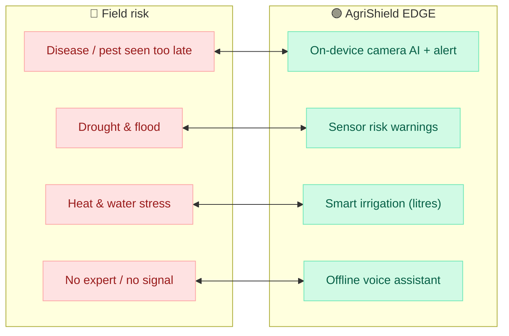
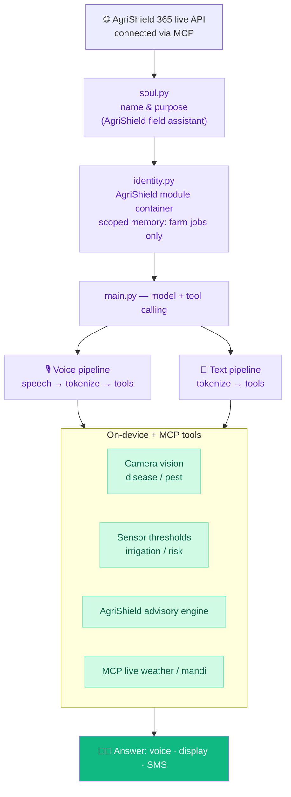
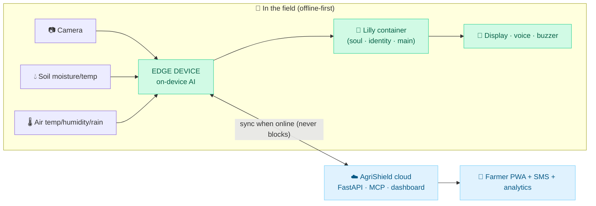
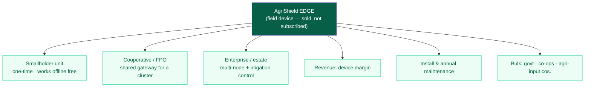
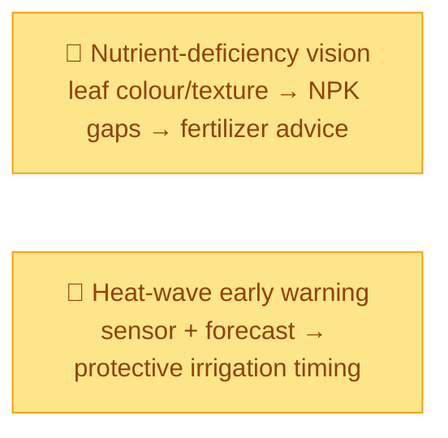

# AgriShield EDGE — SIH 2026 Hardware Deck Build Guide (single version)

**Team RAVEN ROOTS · PS ID 26180 · Category: HARDWARE · Theme: Agriculture, FoodTech & Rural Development**
**Product name:** **AgriShield EDGE** — the field-deployable Smart Farming Assistant (the hardware
twin of our AgriShield 365 app).
**Live companion app (the device's brain & demo):** https://agrishield365.web.app

> ONE document for both the live PPTX and the uploaded PDF — there is **no video slide**; every
> slide is pictorial/diagram-driven. Fixed **6-slide SIH template**. Each diagram below has a
> **copy-paste Napkin AI prompt** AND **copy-paste Mermaid code** (mermaid.live → light theme →
> export SVG). Short labels (≤5 words), emerald/green brand, navy titles, RAVEN ROOTS raven logo
> in the top-left oval, SIH bulb top-right.

**Hardware PS title (verbatim for slide 1):**
*"A field-deployable AI-powered Smart Farming Assistant that helps farmers detect crop diseases,
pests, nutrient deficiencies, and irrigation needs at an early stage, while improving resilience
against droughts, floods, heat waves, and other agricultural risks common in India… through
real-time on-device intelligence."*

---

## SLIDE 1 — TITLE PAGE (form-fill)

- **Problem Statement ID —** `26180`
- **Problem Statement Title —** A field-deployable AI-powered Smart Farming Assistant for early
  crop-disease, pest, nutrient-deficiency and irrigation detection with on-device edge AI
- **Theme —** Agriculture, FoodTech & Rural Development
- **PS Category —** **Hardware**
- **Team ID —** `[FILL FROM SIH PORTAL]`
- **Team Name —** RAVEN ROOTS
- **Product:** AgriShield EDGE — field-deployable edge-AI Smart Farming Assistant

**Logo:** RAVEN ROOTS raven in the top-left oval.

**Speaker notes (~20 sec):**
> "For problem statement 26180, we built AgriShield EDGE — a field-deployable smart-farming
> assistant. It puts crop-disease and pest detection, smart irrigation and disaster alerts on a
> low-cost device that runs in the farm itself, works without internet, and speaks to the farmer.
> It is the hardware twin of our already-live AgriShield 365 platform."

---

## SLIDE 2 — PROPOSED SOLUTION (no video — fully pictorial)

**IDEA TITLE:** AgriShield EDGE — *an AI agronomist that lives in your field.*

Layout: three bands (Lanezy style) — left problem boxes, centre **device hero image**, right
services; bottom = Risk ⇄ Solution strip.

**Left — real-world issue boxes:**
- Crop diseases, pests and water stress are spotted **too late** — up to **40% yield lost** (CICR)
- Droughts, floods and heat waves are rising; smallholders have **no field-level early warning**
- Expert advice needs internet & literacy — fields often have **neither**
- Irrigation is guesswork — **~30% water wasted** (FAO-56)

**Centre — device hero (generate/place a render):**
> A compact weatherproof field unit: a small solar panel on top, a camera lens on a short arm
> aimed at the crop, soil-moisture & temperature probes in the ground, an air temp/humidity
> sensor, a small status screen with a green "healthy" light and a speaker grille — mounted on a
> bamboo stake at the field edge, warm sunrise, Indian farm background. Clean product-render style.

The device = **camera + environmental sensors + on-device AI + local display/voice**, powered by
solar, working offline.

**Right — what it does (the PS 8 capability areas, short labels):**
1. 🐛 Camera AI — disease & pest detection with early alerts
2. 💧 Soil moisture & irrigation scheduling (FAO-56)
3. 🌦️ Drought / flood / rain / environmental risk monitoring
4. 🧠 On-device edge AI — works with no internet, instant
5. 🔔 Simple advisories — display, voice, SMS ("irrigate now", "pest rising")
6. 📊 Farm analytics — history, trends, yield-risk on the mobile dashboard
7. 📶 Scales from one smallholder field to cooperatives & estates

### 📊 DIAGRAM H1 — Risk ⇄ Solution strip (bottom)

**Napkin AI prompt:**
> Two-row comparison titled "From field risk to edge intelligence". Top red rounded boxes (field
> risks): "Disease/pest seen too late", "Drought & flood", "Heat & water stress", "No expert
> nearby / no signal". Double-headed arrows down to green rounded boxes (AgriShield EDGE answers):
> "On-device camera AI + early alert", "Environmental sensor warnings", "Smart irrigation in
> litres", "Offline voice assistant on the device". Flat red-vs-emerald, navy heading.

**Mermaid:**

**Speaker notes (~70 sec):**
> "The problem is physical as much as digital — a farmer cannot carry an app into a field with no
> signal. So we built AgriShield EDGE: a low-cost, solar-powered device that lives in the field.
> A camera watches the crop for disease and pests; soil and air sensors track moisture,
> temperature and rain; and all of it is analysed on the device itself — no cloud needed. It tells
> him, on a screen and by voice and SMS, exactly what to do: irrigate now, pest activity rising,
> flood risk ahead. It is the same verified agronomy engine as our live app, now running at the
> crop's edge."

---

## SLIDE 3 — TECHNICAL APPROACH

Three panels: **left = on-device hardware & sensing**, **centre = the Lilly AI containerisation
pipeline (our signature)**, **right = edge/cloud architecture + tech stack**.

### Left — hardware & sensing
- **Camera** (leaf/plant images) → on-device disease/pest model
- **Soil moisture + soil temperature probes**; **air temp/humidity (DHT)**; optional rain/light
- **Edge compute:** low-cost board (Raspberry Pi-class / ESP32-S3) running **TFLite/MobileNet-class
  on-device vision** + our ported threshold **rule engine**
- **Solar panel + Li-ion battery**, weatherproof enclosure, status screen + buzzer + speaker
- **Outputs:** local display · voice · SMS · our mobile PWA dashboard

### 📊 DIAGRAM H2 — "Lilly" AI containerisation pipeline (centre; the key technical story)

We reuse a proven assistant — **Lilly** (an existing AI agent) — and **containerise** her into an
AgriShield-only agronomy brain, with our live platform wired in via **MCP** (Model Context
Protocol).

**Napkin AI prompt:**
> A vertical pipeline diagram titled "Containerising Lilly into AgriShield EDGE". Top: a node
> "AgriShield 365 platform (live web/API) connected via MCP". Arrow down to a box "soul.py — sets
> Lilly's name & purpose (AgriShield field assistant)". Arrow to "identity.py — AgriShield 360
> module container (scope + memory: farm jobs only)". Arrow to "main.py — model & tool routing",
> which splits into two lanes: "Voice pipeline (speech → tokenize → tools)" and "Text pipeline
> (tokenize → tools)". The tools lane shows four chips: "Camera vision (disease/pest)", "Sensor
> thresholds (irrigation/risk)", "AgriShield advisory engine", "MCP live data". Output at bottom:
> "Farmer answer — voice / display / SMS". Use blue/purple for the pipeline, emerald for tools.

**Mermaid:**

> **Key point to say aloud:** "Lilly can currently answer anything; containerisation scopes her
> memory, identity and tools so that in the field she answers only AgriShield farm questions —
> reliably, on-device."

### 📊 DIAGRAM H3 — Edge system architecture (right)

**Mermaid:**

**Tech-stack card strip (DevWise pills):** Hardware (edge board, camera, soil/air sensors, solar
+battery) · On-device AI (TFLite vision, rule engine) · Assistant (Python: soul.py / identity.py /
main.py, **MCP**, speech-to-text) · Cloud & app (FastAPI, our live React PWA, Firebase, Open-Meteo).

**Speaker notes (~80 sec):**
> "On the hardware side, a camera and soil-and-air sensors feed an edge board that runs a
> lightweight vision model and our threshold engine entirely locally — solar powered, no signal
> needed. For the intelligence layer we did not start from zero: we took Lilly, a working AI
> assistant, and containerised her. In soul.py we set her name and purpose; identity.py loads the
> AgriShield module and scopes her memory to farm jobs; main.py routes every request — spoken or
> typed, both tokenised — to the right tools: camera vision, sensor thresholds, our advisory
> engine, and live data fetched through MCP from our already-running platform. She then answers
> by voice, on the display, or over SMS. She only talks farming — by design. When the device is
> online it syncs to the cloud; offline, it never stops working."

---

## SLIDE 4 — FEASIBILITY, VIABILITY & PRODUCT BUSINESS MODEL

Three pinned panels (Lanezy cork-board style): **Feasibility** · **Viability** · **Product
Business Model** (this is a **product** business — the farmer BUYS the device; core works offline,
no subscription).

**Feasibility panel:**
- ♻️ **Reuses our live platform** — the agronomy engine, dashboards and advisories already run
  (agrishield365.web.app); the device ports the same brain to the edge
- 💰 **Low BOM** — mass-market edge board, camera, soil/air sensors, solar+battery; no paid cloud
  needed for core function
- 📈 **Scalable** — one design serves a smallholder plot or, clustered, a cooperative/estate
- 🔌 **Offline by design** — edge AI + local sensors work through drought/flood/no-signal events

**Viability panel:**
- 🔍 Proven software brain already deployed & device-tested
- 🤝 Trusted advice — ICAR/TNAU/FAO thresholds + "confirm with KVK officer"
- 🔧 Simple, rugged, solar, local-language voice → low literacy barrier
- ☀️ Solar + low power fits real Indian field conditions

**Challenges → strategies (small strip):** field power → solar + low-power sensors; cost for
smallholders → low BOM + **shared/cooperative ownership model**; rough handling → weatherproof
enclosure; connectivity → edge-first, sync only when online.

### 📊 DIAGRAM H4 — Product-based business model (hardware sale, not subscription)

**Napkin AI prompt:**
> A product business-model tree titled "A product farmers buy — not a subscription". Top node
> "AgriShield EDGE device". Three product tiers branching as cards: "Smallholder unit — one-time
> affordable device for a single field, core alerts work offline free", "Cooperative / FPO shared
> gateway — one node serves a cluster, group procurement", "Enterprise / estate — multi-node
> deployment with irrigation-controller integration". Underneath three revenue chips: "Device
> hardware margin", "Installation & annual maintenance", "Bulk govt / cooperative / agri-input
> company procurement". Green/navy tree, clean.

**Mermaid:**

**Speaker notes (~70 sec):**
> "Feasibility is unusually strong because the brain already exists and is live — the device
> ports proven software onto cheap, solar, offline hardware. The business model is a product, not
> a service: a farmer buys one device and it works for years without any subscription or
> connectivity bill. We sell three ways — an affordable single-field unit, a shared gateway that a
> farmer cooperative buys together to keep per-farmer cost minimal, and multi-node packs for
> estates. Revenue comes from the hardware margin, installation and maintenance, and bulk
> procurement through government schemes, FPOs and agri-input companies."

---

## SLIDE 5 — IMPACT & BENEFITS (with future-capability teaser)

**Impact wheel (left) + crisis-vs-EDGE bars (right) + Social/Economic/Environmental chevrons
(bottom) + gold future-teaser band.**

### Impact wheel nodes
1. **Yield protected** — early disease/pest alerts cut the ~40% loss (CICR)
2. **Lower input costs** — targeted spraying & sensor-timed irrigation
3. **Water saved** — ~30% via soil-moisture + FAO-56 scheduling
4. **Disaster resilience** — drought/flood/rain field-level alerts before losses
5. **Inclusive** — offline, local-language voice for low-literacy & no-signal areas

### 📊 DIAGRAM H5 — "Without vs with AgriShield EDGE" bars
Grey today vs green with EDGE: **Pest/disease loss 40% → <10%** · **Water wasted 30% → <10%** ·
**Disaster lead time 0–1 day → 3–5 days** · **Fields with on-site diagnostics ~0% → every node**

**Chevron chain:** 🔵 Social (inclusive, voice, no signal needed) → 🟣 Economic (yield up, cost
down, product is a one-time asset) → 🟢 Environmental (less pesticide, less water).

**Beneficiary strip:** smallholder farmers · FPOs/cooperatives · KVK & agri department.

### 📊 DIAGRAM H6 — "Coming next" gold teaser band (hardware roadmap only)

Short hook only — full detail in the report/video. Two future capabilities.

**Napkin AI prompt:**
> A slim gold-and-emerald "future capabilities" banner. Left a small icon (leaf with magnifier and
> a sun/heat wave). Two gold cards: "Nutrient-deficiency detection — camera AI reads leaf colour &
> texture to flag nitrogen/phosphorus/potassium deficiency and advise fertilizer" and "Heat-wave
> early warning — sensor + forecast model alerts before heat stress and auto-advises protective
> irrigation timing". Title "Next on EDGE". Compact, flat.

**Mermaid:**

**Teaser line (one sentence):** *"Next, EDGE will read nutrient deficiency from the leaf and warn
of heat waves before they stress the crop."*

**Speaker notes (~65 sec):**
> "The impact is concrete: disease and pest alerts early can cut the forty-percent loss figure down
> to a fraction; soil sensors and FAO-based scheduling save about thirty percent of water; and
> environmental alerts give days of lead time against drought and flood — all offline, in the
> farmer's language. Socially it reaches farmers no app can; economically it is a one-time asset
> that lifts yield and cuts cost; environmentally it means spraying and watering only when needed.
> And the roadmap is already in the lab: the next release adds vision-based nutrient-deficiency
> detection and heat-wave early warning — but that detail is in our report."

---

## SLIDE 6 — RESEARCH & REFERENCES (squeezed) + links

Compact hexagon source chain (small hexes, source names):
**ICAR – CICR Nagpur** (pest loss ~40%, IPM) → **TNAU Agritech Portal** (disease/pest triggers) →
**FAO-56 Paper 56** (irrigation Kc) → **IMD Agromet** (3–5 day lead) → **Open-Meteo** (weather) →
**Edge AI / TFLite & on-device inference** references → **Model Context Protocol (MCP)** docs.

**Bottom link panel — "See it live & read more":**
- 📱 **Companion app (the device's brain, live now):** https://agrishield365.web.app + QR
- 💻 **Code / GitHub:** github.com/ramrounakmukherjee-blip/AgriShield365
- 📺 **Demo video** & 📄 **full Google-Docs hardware report** (device BOM, Lilly containerisation,
  nutrient/heatwave roadmap) — `[PASTE LINKS]`

**"What's next" footer (one line):**
> 🌱 Coming to EDGE: nutrient-deficiency vision & heat-wave early warning · full details in report.

**Speaker notes (~25 sec):**
> "Every threshold is grounded in ICAR, TNAU and FAO sources, and the edge-AI and assistant pieces
> build on open, proven standards. The companion app is live right now — the QR opens it on your
> phone — and the full hardware report with the bill of materials and the Lilly containerisation
> detail is linked. Thank you — RAVEN ROOTS, happy to take your questions."

---

# ASSETS / PREP CHECKLIST (hardware deck)

- [ ] **Device hero render** (Napkin/AI image or a clean product sketch) for slide 2 centre
- [ ] **QR code PNG** → https://agrishield365.web.app
- [ ] Diagrams to generate: H1 risk⇄solution · H2 Lilly pipeline (signature) · H3 edge
      architecture · H4 product business tree · H5 impact wheel · H6 future teaser
- [ ] Optional: photo of the actual sensor/camera prototype or the simulation video frame
- [ ] RAVEN ROOTS raven logo in every top-left oval; Team ID from portal on slide 1
- [ ] Google-Docs hardware report (BOM, soul.py/identity.py/main.py detail, MCP setup, nutrient &
      heatwave roadmap) — linked on slide 6 *(can draft on request)*

**Always exactly 6 slides.** Do not mention the software-only satellite module in the hardware deck.
Future capabilities shown = **nutrient deficiency + heat waves** only.
