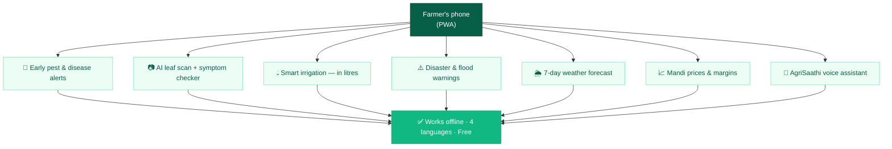
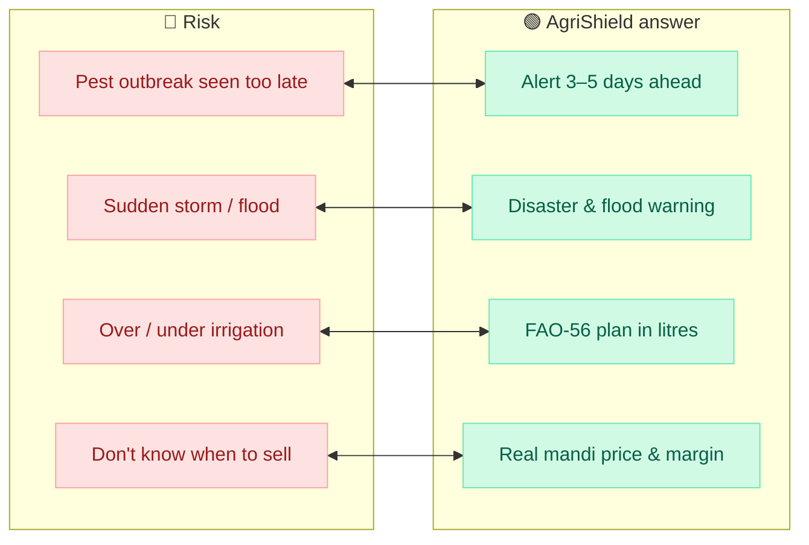
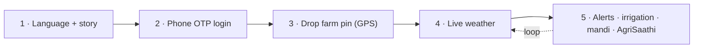
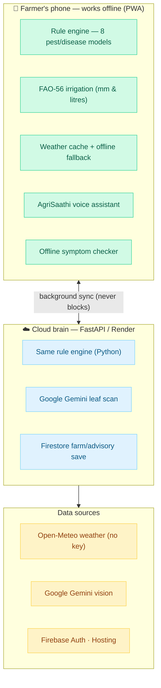
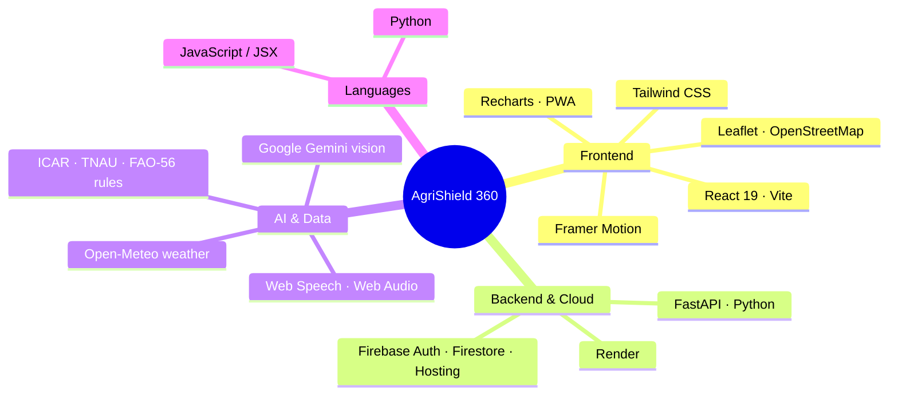
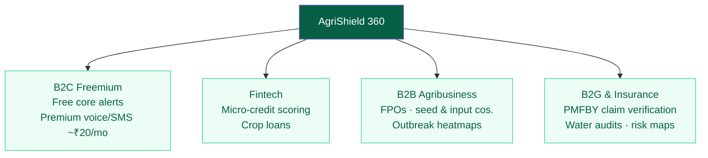
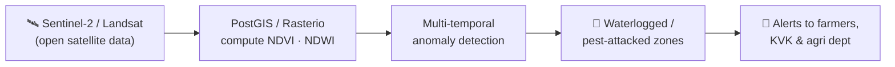

```mermaid
flowchart LR
    M1["01 Pilot<br/>3 crops"] --> M2["02 All districts"] --> M3["03 Real SMS/push"]
    M3 --> M4["04 Live mandi feed"] --> M5["⭐ 05 KhetiScan<br/>satellite NDVI/NDWI"]
    M5 --> M6["06 Organic + 100 rare seeds"] --> M7["07 Multi-crop fertility"]
    M7 --> M8["08 Community · 22 languages · KVK"]
    classDef star fill:#fde68a,color:#92400e,stroke:#f59e0b;
    classDef std fill:#ecfdf5,color:#065f46,stroke:#34d399;
    class M5 star; class M1,M2,M3,M4,M6,M7,M8 std;
```

# AgriShield 365 — SIH 2026 Deck v2 (live pitch + official PDF)

**Team RAVEN ROOTS · PS ID SIH26131 · Software · Theme: Agriculture, FoodTech & Rural Development**
**Live app:** https://agrishield365.web.app · **Repo:** github.com/ramrounakmukherjee-blip/AgriShield365

This file supersedes `AgriShield365-SIH2026-Deck.md` for the actual build. It contains:
**(A)** the two deck variants (live PPTX with a 1:30 product video vs. the SIH-uploaded
all-pictorial PDF), **(B)** every diagram as a **copy-paste Napkin AI prompt** AND
**copy-paste Mermaid code**, **(C)** on-slide text, **(D)** speaker notes.

> **Napkin AI tip:** feed it the prompt under each diagram; it produces a clean
> infographic you export as PNG/SVG. **Mermaid tip:** paste the code into mermaid.live,
> pick a light theme, export SVG for crisp PPT. Make every diagram **one idea, short
> labels (≤5 words)**, emerald/green brand with navy headings. RAVEN ROOTS raven logo
> in the top-left oval on every slide; SIH bulb top-right.

---

# PART A — THE TWO VERSIONS OF OUR DECK

**Version 1 — LIVE pitch deck (Sep 10–11 internal + SIH final if selected):** a working
`.pptx` where **Slide 1 is 75% the 1:30 product walkthrough video** (plays in PowerPoint)
+ 25% a services flowchart, QR, live link, unlisted YouTube link. Then the content slides.
Judges watch the story + product instead of reading bullets.

**Version 2 — SIH uploaded PDF:** the same 6 official sections, but **Slide 1 replaces the
video with a static pictorial hero** (problem → solution in one big visual); the PDF holds
all the diagrams that the live talk narrates. Include QR + YouTube link on slide 1 too, so a
judge can still watch the full 8-min walkthrough at their desk.

**Shared slide list (live pitch):**
1. **Hero** — video (75%) + services flowchart (25%) + QR/links
2. Proposed Solution (problem → innovation)
3. Technical Approach (pipeline + tech stack + screenshots + QR)
4. Feasibility & Viability (feasibility / challenges / strategies **+ business model**)
5. Impact & Benefits (impact wheel, risk→solution, data chart)
6. Future Plans — **KhetiScan reveal + roadmap** *(live pitch only — the "masterstroke")*
7. Research & References (+ full report link)

**Official PDF** folds slide-6 future material into slides 4/5/7 to stay within 6.

---

# PART B — SLIDE BY SLIDE

## SLIDE 1 — HERO (live: video + services · PDF: pictorial)

### Layout (live PPTX)
- **Left 75%:** embedded **1:30 walkthrough video** (cinematic story → OTP → map onboarding
  → pest alerts with "Why?" → JalRakshak litres → AgriSaathi sprout chat → Market real
  prices → Crop Health). Autoplay on click, loop off.
- **Right 25%:** services flowchart (Napkin/Mermaid below), QR code, and a panel of 3 links:
  - 🌐 **Live app:** agrishield365.web.app
  - 📺 **Full 8-min walkthrough (unlisted YouTube):** `[PASTE LINK — to be recorded]`
  - 💻 **Code / detailed report:** GitHub repo link + Google Docs report link
- Footer line: *SIH26131 · Early detection & management of crop diseases & pest infestations*

### 📊 DIAGRAM 1 — "AgriShield 365 services" (right 25% column)

**Napkin AI prompt:**
> A clean vertical flow diagram titled "AgriShield 365 — what the farmer gets". Start from a
> single rounded node at top labelled "Farmer's phone (PWA)". Branch down to 7 service cards
> as short-label rounded boxes connected with thin arrows: (1) "Early pest & disease alerts",
> (2) "AI leaf scan + symptom checker", (3) "Smart irrigation — litres", (4) "Disaster & flood
> warnings", (5) "7-day weather forecast", (6) "Mandi prices & margins", (7) "AgriSaathi voice
> assistant". At the bottom a wide badge: "Works offline · 4 languages · Free". Use a green
> and emerald palette with a navy title, flat modern style, lots of white space.

**Mermaid code (mermaid.live):**

### Slide 1 (PDF variant) — pictorial hero
Replace the video with the **Diagram 2 "From loss to protection" pipeline** (Napkin below),
big, so the problem→solution lands in one glance without video.

**Napkin AI prompt (PDF hero):**
> A wide left-to-right "before vs after" infographic. LEFT (grey/red): a worried farmer, a
> pest-damaged leaf, a storm cloud, label "Sees pests & storms too late — up to 40% of yield
> lost (CICR)". A bold arrow across the middle labelled "AgriShield 365". RIGHT (green): a
> happy farmer with a phone showing alerts, sprout mascot, label "Warned 3–5 days early — in
> his language, offline". Below the arrow list 4 mini chips: "Rule-engine pest alerts",
> "FAO-56 irrigation", "AgriSaathi AI assistant", "Mandi prices". Flat modern, emerald/navy.

**Speaker notes (live, ~40 sec):**
> "Rather than read slides about our product, watch it for ninety seconds — this is a real,
> deployed app, not a mockup. The link and a QR are on the right, along with an eight-minute
> deep-dive video if you want every detail. As you watch, the services panel lists everything
> the farmer gets — from pest alerts to an AI assistant — all working offline, in four
> languages, free."

---

## SLIDE 2 — PROPOSED SOLUTION

**IDEA TITLE:** AgriShield 365 — *Every Farmer, Every Season, Protected.*

Layout: three columns (Lanezy/Lanezy-style left problem boxes, centre story image, right
solution), plus a **Risk ⇄ Solution** matching row (Lanezy's red-vs-green strip is a winner
pattern) along the bottom.

**Left column boxes:**
- **Real-world issue:** pests/disease seen too late; storms arrive unwarned; advice is not in
  the farmer's language, not offline, not on his phone.
- **Why it matters:** up to **40% of yield** lost to pests/disease (CICR, Nagpur); **3–5-day**
  forecasts from IMD never reach the field; **~30% of irrigation water** wasted (FAO-56).
- **Solution:** one installable web app that warns early, tells him how much to water, checks
  leaves with AI, and answers by voice — grounded in ICAR/TNAU/FAO science.

**Centre:** cinematic story painting (scene 6) + AgriSaathi sprout mascot.

**Right column — solution boxes (short labels):**
🐛 8 pest/disease models on live weather × crop stage · "Why this alert?" + action
📷 Crop Health: Gemini leaf scan + offline symptom checker
💧 JalRakshak: FAO-56 → exact mm & litres, skips rain days
🤖 AgriSaathi: offline voice assistant + guided onboarding
🌐 EN/हिन्दी/বাংলা/मরाठी · 📶 offline PWA · stays signed in

### 📊 DIAGRAM 3 — Risk ⇄ Solution strip (bottom of slide)

**Napkin AI prompt:**
> A two-row comparison strip. Top row red rounded boxes labelled "Farmer risks": "Pest outbreak
> seen too late", "Sudden storm / flood", "Over- or under-irrigation", "Don't know when to
> sell". Between each red box and a green box below draw a double-headed arrow. Bottom row
> green rounded boxes labelled "AgriShield answer": "Early rule-engine alert 3–5 days ahead",
> "Disaster & flood warnings", "FAO-56 water plan in litres", "Real mandi price & margin".
> Title "From risk to readiness". Flat, red-vs-emerald, navy headings.

**Mermaid code:**

**Speaker notes (~70 sec):** use the existing script in the v1 doc (problem → four
differences: dual-brain offline, voice/story onboarding, free, live now).

---

## SLIDE 3 — TECHNICAL APPROACH

Three panels: **left = farmer journey ring/cycle**, **centre = system architecture diagrams**,
**right = tech-stack cards + screenshots + QR**.

### 📊 DIAGRAM 4 — Farmer journey cycle (left; Lanezy used a colourful circular flow)

**Napkin AI prompt:**
> A circular process diagram (5 coloured nodes around a ring, arrows clockwise) titled "Farmer
> journey". Nodes: 1 (blue) "Choose language + story" with sub-label "onboarding for low
> literacy"; 2 (yellow) "Phone OTP login"; 3 (green) "Drop farm pin (GPS/map)"; 4 (orange)
> "Live weather fetched"; 5 (red) "Get alerts, irrigation, mandi, ask AgriSaathi". Put a small
> leaf/sprout icon in the centre. Add a side callout "Stays signed in — no repeated login".
> Flat, bright, navy title.

**Mermaid code:**

### 📊 DIAGRAM 5 — Two-brain system architecture (centre; our most important technical visual)

**Napkin AI prompt:**
> An architecture diagram titled "Two-brain, never-blocking design". Left device: a smartphone
> labelled "📱 PWA on the farmer's phone — works offline". Inside it stack: "Rule engine
> (8 pest models)", "FAO-56 irrigation", "Weather cache", "AgriSaathi assistant", "Offline
> symptom checker". A dashed double-arrow connects the phone to a cloud on the right labelled
> "☁️ Cloud brain (FastAPI / Render)". Inside the cloud: "Same rule engine (Python)",
> "Gemini leaf scan", "Firestore save". Around the cloud show three small source chips:
> "Open-Meteo weather", "Google Gemini vision", "Firebase auth/hosting". A bold badge under the
> phone: "Phone computes first → cloud only enriches → never blocks the UI". Use emerald for
> the phone, sky-blue for the cloud, navy labels.

**Mermaid code:**

### 📊 DIAGRAM 6 — Tech-stack cards (right; DevWise/Lanezy pill style)

**Napkin AI prompt:**
> A tech-stack mind-map: central rounded node "AgriShield 365". Four branches as coloured pill
> groups: "Frontend" (React 19, Vite, Tailwind CSS, Framer Motion, Leaflet/OpenStreetMap,
> Recharts, PWA/Workbox); "Languages" (JavaScript/JSX, Python); "Backend & Cloud" (FastAPI,
> Render, Firebase Auth/Firestore/Hosting); "AI & data" (Google Gemini vision, Open-Meteo,
> Web Speech API, Web Audio API, ICAR/TNAU/FAO-56 rules). Flat cards, dashed connectors,
> emerald/navy.

**Mermaid code:**

**Right-bottom:** 3 real screenshots (alerts with Why?, JalRakshak litres, AgriSaathi) +
**QR "Scan to open the live app"**.

**Speaker notes (~75 sec):** existing v1 script (rule engine thresholds, FAO-56, phone-first,
invite judges to scan QR).

---

## SLIDE 4 — FEASIBILITY, VIABILITY & BUSINESS MODEL

Use the **Lanezy pinned-card style**: three vertical board panels — **Feasibility Analysis**
(left) · **Viability** (centre) · **Business Potential** (right). Then a fourth element: the
**revenue tree** (their image-6 monetization diagram), which judges love.

### Panel content
**Feasibility (stars 4.5/5):**
- ♻️ Reuses free infrastructure (Firebase Spark, Render free, keyless Open-Meteo) → ~₹0 setup
- 📈 Scalable deployment — thresholds live in a JSON rules file; new crops = data, not code
- 💲 Cost-effective — PWA, no app store, installs from a link
- 👥 Authority integration ready — OTP auth, Firestore, cloud API

**Viability:**
- 🔍 Proven concept — local-first architecture already deployed & device-tested
- 🤝 Public trust — alerts cite ICAR/TNAU/FAO sources + "confirm with KVK officer"
- 📋 Accountability — every advisory logged (local + cloud history)
- 🏛️ Engagement — AgriSaathi coach + voice for low-literacy users

**Challenges → strategies** (small strip, from v1): offline-first PWA beats connectivity;
whitelisted test OTP now, Blaze upgrade for real SMS; local engine never depends on Gemini
quota; story + voice beat digital-literacy gaps.

### 📊 DIAGRAM 7 — Monetization & sustainability tree (the image-6 business model)

**Napkin AI prompt:**
> A hierarchy/organisational chart titled "Sustainable business model". Top node: "AgriShield
> 360". Four pillars branching down as wide rounded cards, each with 2–3 bullet points:
> Pillar 1 "B2C Freemium for farmers — Free core alerts & risk scores; premium voice/SMS alerts
> ~₹20/month". Pillar 2 "Fintech partners — Micro-credit scoring; crop loans using farm
> advisory & history data". Pillar 3 "B2B Agribusiness — FPOs & seed/fertilizer companies;
> anonymized disease-outbreak heatmaps to pre-position bio-fungicides & inputs". Pillar 4
> "B2G & crop insurance — PM Fasal Bima Yojana (PMFBY) verification; water audits; risk
> mapping for government". Emerald/navy tree, clean.

**Mermaid code:**

**Speaker notes (~70 sec):**
> "Feasibility is a strength — it is already built and runs on free tiers at near-zero cost,
> and adding crops means editing a rules file. On risks, every challenge has a shipped
> mitigation, which is why it works in airplane mode. For sustainability, the core app stays
> free for farmers; revenue comes from three channels: premium voice alerts at twenty rupees a
> month, data-driven agribusiness partnerships that route fungicides to outbreak zones, and
> government integration — notably Fasal Bima crop-insurance verification and water audits."

---

## SLIDE 5 — IMPACT & BENEFITS

Use the **Lanezy impact wheel** (left) + a **current-vs-with-AgriShield bar chart** (right) +
**Social/Economic/Environmental chevrons**.

### 📊 DIAGRAM 8 — Impact wheel (left; dashed circle, numbered nodes)

**Napkin AI prompt:**
> A circular impact diagram. Centre circle split "IMPACTS | BENEFITS" with a sprout icon.
> Around the ring 4 numbered nodes, each with a short heading and one line: 1 "Yield protected —
> up to 40% loss avoided (CICR)"; 2 "Early warning — 3–5 day disaster lead time (IMD/TNAU)";
> 3 "Water saved — ~30% via FAO-56 timed irrigation"; 4 "Income & inclusion — mandi margins,
> voice in 4 languages for low-literacy & women farmers". Soft green/gold palette, navy text.

### 📊 DIAGRAM 9 — "Crisis today vs with AgriShield" bar chart (right)

**Napkin AI prompt:**
> A horizontal bar chart titled "What early warnings change". Categories with two bars each
> (grey = today, green = with AgriShield 365), values as percentages of loss/risk: "Pest yield
> loss: 40% → under 10%"; "Irrigation water wasted: 30% → under 8%"; "Storm/flood preparedness
> lead time: 0–1 day → 3–5 days"; "Farmers reaching advisory in local language: <10% → 100%".
> Clean bar chart, grey-vs-emerald, caption "Estimates grounded in CICR, FAO-56, IMD/TNAU".

**Chevron chain (bottom):** 🔵 Social (inclusive voice/language, disaster safety) → 🟣 Economic
(yield protected, input costs cut, better price) → 🟢 Environmental (threshold-based spraying
cuts chemicals; timed irrigation saves water).

**Beneficiary strip (small):** smallholder farmers · KVK extension workers · state agri dept.

**Speaker notes (~60 sec):** existing v1 script (three beneficiary groups; social/economic/enviro).

---

## SLIDE 6 — FUTURE PLANS (live pitch "masterstroke"; folded into PDF as roadmap lines)

Lead with the reveal. Title: **"What's next — and our breakthrough module."**

### ⭐ KhetiScan — Geospatial Canopy Surveillance (the hero)
Present it as the module that turns a phone app into a regional early-warning system.
- **Technology:** connects to **Copernicus Sentinel-2 / Landsat open satellite data**
  (via PostGIS / Rasterio) — free, government-grade.
- **Detection:** computes **NDVI** = (NIR−Red)/(NIR+Red) and **NDWI** (vegetation & water
  indices) for every field.
- **Anomaly detection:** flags sudden multi-temporal drops across field sectors — pinpointing
  **waterlogged or pest-attacked zones before any field visit**, then pushes alerts.
- **Why it's a leap:** today AgriShield warns one farm from weather; KhetiScan watches **whole
  districts from space** and routes teams to the exact infected sector.

### 📊 DIAGRAM 10 — KhetiScan roadmap (Lanezy winding-road timeline)

**Napkin AI prompt:**
> A winding road/journey timeline with numbered milestone dots, left to right, titled "From
> one phone to every field". Milestones: 01 "Pilot — paddy, potato, cotton (WB & Vidarbha)";
> 02 "All districts — rules-file expansion"; 03 "Real SMS + push alerts (Blaze)"; 04 "Live
> Agmarknet mandi feed"; 05 "KhetiScan satellite NDVI/NDWI — pest & flood zones from space";
> 06 "Organic farming push + 100+ rare paddy seed protection"; 07 "Multi-crop land fertility
> advisor"; 08 "Farmer community + all 22 languages + KVK dashboards". Make milestone 05 bigger
> and gold to mark the breakthrough. Green road, navy labels.

**Mermaid code:**

### 📊 DIAGRAM 11 — KhetiScan science flow (small, to show it's real)

**Mermaid code:**

**Other future pillars (short cards):**
- 🌿 **Promote organic / natural farming** guidance
- 🌾 **Protect 100+ rare paddy seed varieties** (heritage-seed library & advisory)
- 🔁 **Multi-cropping & soil fertility advisor** — suggest crops that improve land health
- 👨‍🌾 **Farmer community** — share advisories, outbreak reports, and mandi tips (KhetiScan feeds
  the community map)

**Speaker notes (~60 sec):**
> "What you've seen is built and live. If you take us forward, here's our breakthrough:
> KhetiScan. Today we warn one farm from its weather; KhetiScan watches entire districts from
> space — Sentinel and Landsat open satellite data, processed into vegetation and water indices,
> flag pest-attacked or waterlogged sectors before anyone visits the field. Around it we grow
> organic-farming guidance, a library protecting over a hundred rare paddy seeds, a multi-crop
> soil-health advisor, and a farmer community. This is where one phone becomes a regional
> safety net."

---

## SLIDE 7 — RESEARCH & REFERENCES

Lanezy style: a **hexagon chain across the top**, each hexagon a source with a LINK, and
screenshots / report panel along the bottom.

Hexagons (left → right): **ICAR – CICR Nagpur** (pest loss ~40%, cotton IPM) → **TNAU Agritech
Portal** (disease/pest trigger conditions) → **FAO-56 Paper 56** (crop Kc coefficients) → **IMD
Agromet** (3–5 day lead time) → **Agmarknet** (mandi prices) → **Open-Meteo** (weather API) →
**Copernicus Sentinel-2 / Landsat** (KhetiScan roadmap).

**Bottom panel — "Try it yourself":** app QR + web app link · API health link · GitHub repo ·
**unlisted YouTube walkthrough** · **full Google-Docs detailed report** link.

**Speaker notes (~25 sec):**
> "Every threshold and number traces to a verifiable institution — ICAR, TNAU, the FAO
> irrigation standard, the meteorological department, and for our roadmap the EU's open
> Sentinel satellites. And unlike a concept, it is all live right now. A full written report and
> an eight-minute video walkthrough are linked here. Thank you — RAVEN ROOTS, ready for your
> questions."

---

# PART C — ASSETS / PREP CHECKLIST

**To record/create:**
- [ ] **1:30 golden-path walkthrough video** (embed in live PPTX slide 1)
- [ ] **~8 min unlisted YouTube** full walkthrough (you narrating part-by-part) → paste link on
      slides 1 & 7
- [ ] **Google Docs detailed report** (everything the deck couldn't fit) → paste link on slide 7
      *(I will draft this report for you next — just say the word)*
- [ ] **QR code PNG** for https://agrishield365.web.app (free QR generator)
- [ ] Screenshots (Incognito, mobile width): story, OTP, map, alerts+Why?, JalRakshak litres,
      forecast chart, AgriSaathi chat, Crop Health, Market real prices
- [ ] RAVEN ROOTS raven logo in every top-left oval

**Diagram build order (Napkin/Mermaid):** D1 services · D2 PDF hero · D3 risk⇄solution ·
D4 journey · D5 two-brain architecture (most important) · D6 tech stack · D7 revenue tree ·
D8 impact wheel · D9 comparison bars · D10 roadmap · D11 KhetiScan flow.

**Slide-count rule:** live deck = 7 slides (video hero + future reveal); official PDF = 6
sections (fold slide-6 KhetiScan/roadmap into slides 4/5/7 as future-scope bullets so the
uploaded file still obeys the SIH template).
