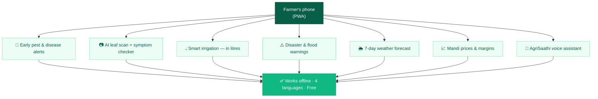
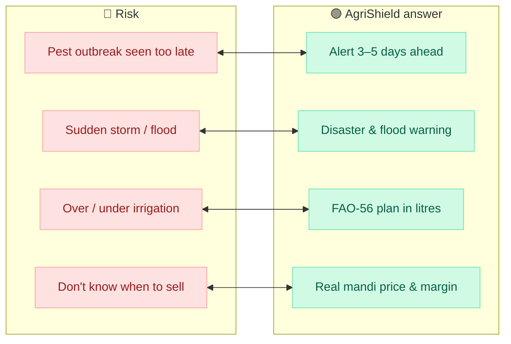
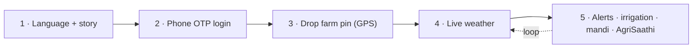
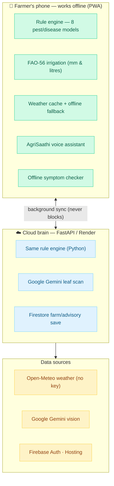
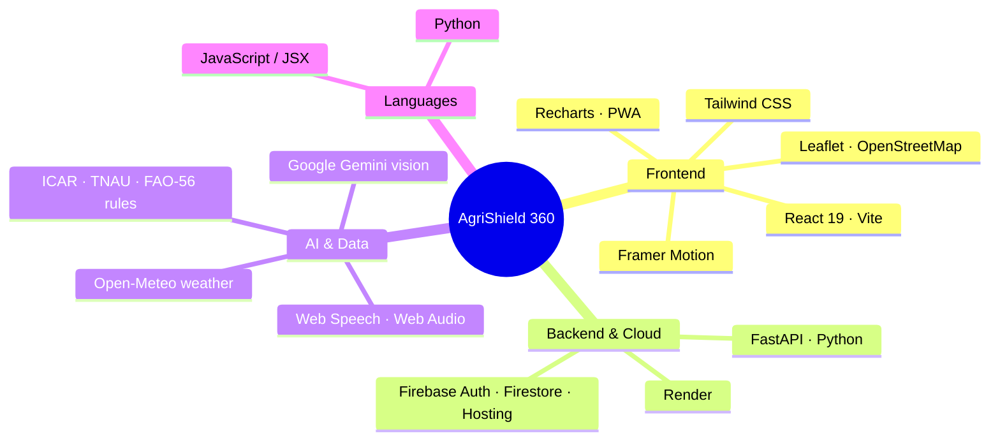
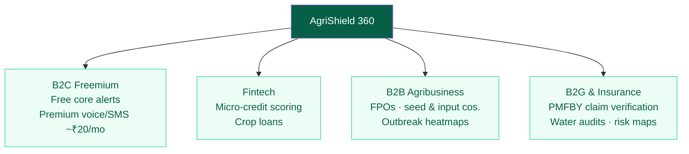
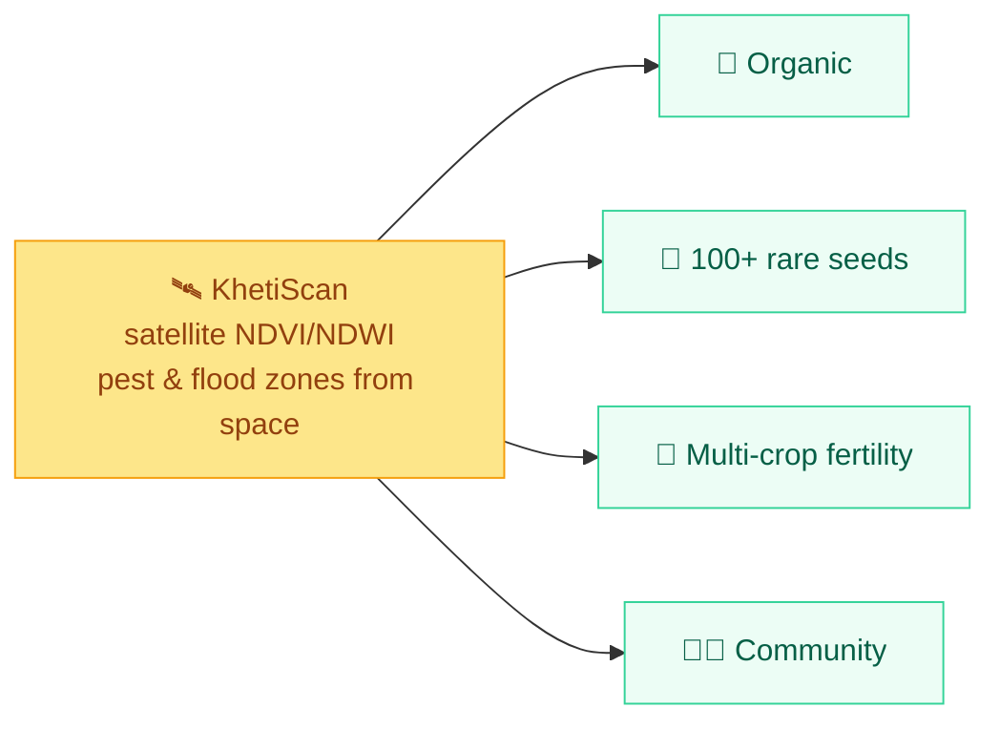
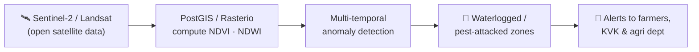

# AgriShield 365 — SIH 2026 Deck v2 (live pitch + official PDF)

**Team RAVEN ROOTS · PS ID SIH26131 · Software · Theme: Agriculture, FoodTech & Rural Development**
**Live app:** https://agrishield365.web.app · **Repo:** github.com/ramrounakmukherjee-blip/AgriShield365

This file supersedes `AgriShield365-SIH2026-Deck.md` for the actual build. It contains:
**(A)** the two deck variants (live PPTX with a 1:30 product video vs. the SIH-uploaded
all-pictorial PDF), **(B)** every diagram as a **copy-paste Napkin AI prompt** AND
**copy-paste Mermaid code**, **(C)** on-slide text, **(D)** speaker notes.

> **Napkin AI tip:** feed it the prompt under each diagram; it produces a clean
> infographic you export as PNG/SVG. **Mermaid tip:** paste the code into mermaid.live,
> pick a light theme, export SVG for crisp PPT. Make every diagram **one idea, short
> labels (≤5 words)**, emerald/green brand with navy headings. RAVEN ROOTS raven logo
> in the top-left oval on every slide; SIH bulb top-right.

---

# PART A — THE TWO VERSIONS OF OUR DECK

**Version 1 — LIVE pitch deck (Sep 10–11 internal + SIH final if selected):** a working
`.pptx` where **Slide 1 is 75% the 1:30 product walkthrough video** (plays in PowerPoint)
+ 25% a services flowchart, QR, live link, unlisted YouTube link. Then the content slides.
Judges watch the story + product instead of reading bullets.

**Version 2 — SIH uploaded PDF:** the same 6 official sections, but **Slide 1 replaces the
video with a static pictorial hero** (problem → solution in one big visual); the PDF holds
all the diagrams that the live talk narrates. Include QR + YouTube link on slide 1 too, so a
judge can still watch the full 8-min walkthrough at their desk.

**The official deck is FIXED at 6 slides. We never add a 7th.** Slide 1 (Title) is a
form-fill page and cannot hold content. The video/future material is folded INTO the
mandated slides as below.

**Slide map (both versions):**
1. **Title page** — fixed SIH form-fill (PS ID, title, theme, Software, Team ID, RAVEN ROOTS);
   raven logo in the oval. NO content/video here.
2. **Proposed Solution** — LIVE PPTX: 75% embedded 1:30 walkthrough video + 25% services
   flowchart + QR/links. PDF: static pictorial problem→solution→services (video replaced by
   the "loss→protection" hero diagram; QR + YouTube link still present).
3. **Technical Approach** — farmer journey cycle + two-brain architecture + tech-stack cards
   + screenshots + QR.
4. **Feasibility & Viability** — feasibility / viability / challenges→strategies **+ business
   model tree**.
5. **Impact & Benefits** — impact wheel + crisis-vs-AgriShield chart + Social/Economic/
   Environmental chevrons **+ a compact "Future: KhetiScan" teaser band** (the hook — short,
   pictorial; full detail lives in the report).
6. **Research & References** — squeezed hexagon source chain + QR/links **+ a one-line
   "What's next" footer** pointing at KhetiScan/roadmap and the detailed report.

> The **full KhetiScan explanation, the 8-min video, and the deep report** are linked (QR /
> YouTube / Google Docs) so judges can go deep without us exceeding the 6-slide limit.

---

# PART B — SLIDE BY SLIDE

## SLIDE 2 — PROPOSED SOLUTION (live: video hero · PDF: pictorial)

### Live PPTX layout
- **Left 75%:** embedded **1:30 walkthrough video** (cinematic story → OTP → map onboarding
  → pest alerts with "Why?" → JalRakshak litres → AgriSaathi sprout chat → Market real
  prices → Crop Health). Autoplay on click. The video itself walks the problem → solution →
  services so judges don't read.
- **Right 25%:** services flowchart (Diagram 1 below), QR code, and a panel of 3 links:
  - 🌐 **Live app:** agrishield365.web.app
  - 📺 **Full 8-min walkthrough (unlisted YouTube):** `[PASTE LINK — to be recorded]`
  - 💻 **Code / detailed report:** GitHub repo link + Google Docs report link
- Footer line: *SIH26131 · Early detection & management of crop diseases & pest infestations*

### PDF variant (no video)
Replace the video with the static **"From loss to protection" hero diagram (Diagram 2)**, big,
so problem→solution→services land in one glance; keep the services flowchart + Risk ⇄ Solution
strip (Diagram 3) + QR/YouTube link so a judge can still watch the full video.

### 📊 DIAGRAM 1 — "AgriShield 365 services" (right 25% column)

**Napkin AI prompt:**
> A clean vertical flow diagram titled "AgriShield 365 — what the farmer gets". Start from a
> single rounded node at top labelled "Farmer's phone (PWA)". Branch down to 7 service cards
> as short-label rounded boxes connected with thin arrows: (1) "Early pest & disease alerts",
> (2) "AI leaf scan + symptom checker", (3) "Smart irrigation — litres", (4) "Disaster & flood
> warnings", (5) "7-day weather forecast", (6) "Mandi prices & margins", (7) "AgriSaathi voice
> assistant". At the bottom a wide badge: "Works offline · 4 languages · Free". Use a green
> and emerald palette with a navy title, flat modern style, lots of white space.

**Mermaid code (mermaid.live):**

### Slide 1 (PDF variant) — pictorial hero
Replace the video with the **Diagram 2 "From loss to protection" pipeline** (Napkin below),
big, so the problem→solution lands in one glance without video.

**Napkin AI prompt (PDF hero):**
> A wide left-to-right "before vs after" infographic. LEFT (grey/red): a worried farmer, a
> pest-damaged leaf, a storm cloud, label "Sees pests & storms too late — up to 40% of yield
> lost (CICR)". A bold arrow across the middle labelled "AgriShield 365". RIGHT (green): a
> happy farmer with a phone showing alerts, sprout mascot, label "Warned 3–5 days early — in
> his language, offline". Below the arrow list 4 mini chips: "Rule-engine pest alerts",
> "FAO-56 irrigation", "AgriSaathi AI assistant", "Mandi prices". Flat modern, emerald/navy.

**Speaker notes (live, ~40 sec):**
> "Rather than read slides about our product, watch it for ninety seconds — this is a real,
> deployed app, not a mockup. The link and a QR are on the right, along with an eight-minute
> deep-dive video if you want every detail. As you watch, the services panel lists everything
> the farmer gets — from pest alerts to an AI assistant — all working offline, in four
> languages, free."

---

### Slide 2 supporting content — problem → solution → services

**IDEA TITLE:** AgriShield 365 — *Every Farmer, Every Season, Protected.*

In the **live PPTX** this is exactly what the 1:30 video narrates; keep only the services
flowchart (Diagram 1) + QR beside the video. In the **PDF**, lay it out as three columns
(Lanezy-style left problem boxes, centre story image, right solution), plus the **Risk ⇄
Solution** matching row (Lanezy's red-vs-green strip) along the bottom:

**Left column boxes:**
- **Real-world issue:** pests/disease seen too late; storms arrive unwarned; advice is not in
  the farmer's language, not offline, not on his phone.
- **Why it matters:** up to **40% of yield** lost to pests/disease (CICR, Nagpur); **3–5-day**
  forecasts from IMD never reach the field; **~30% of irrigation water** wasted (FAO-56).
- **Solution:** one installable web app that warns early, tells him how much to water, checks
  leaves with AI, and answers by voice — grounded in ICAR/TNAU/FAO science.

**Centre:** cinematic story painting (scene 6) + AgriSaathi sprout mascot.

**Right column — solution boxes (short labels):**
🐛 8 pest/disease models on live weather × crop stage · "Why this alert?" + action
📷 Crop Health: Gemini leaf scan + offline symptom checker
💧 JalRakshak: FAO-56 → exact mm & litres, skips rain days
🤖 AgriSaathi: offline voice assistant + guided onboarding
🌐 EN/हिन्दी/বাংলা/मরाठी · 📶 offline PWA · stays signed in

### 📊 DIAGRAM 3 — Risk ⇄ Solution strip (bottom of slide)

**Napkin AI prompt:**
> A two-row comparison strip. Top row red rounded boxes labelled "Farmer risks": "Pest outbreak
> seen too late", "Sudden storm / flood", "Over- or under-irrigation", "Don't know when to
> sell". Between each red box and a green box below draw a double-headed arrow. Bottom row
> green rounded boxes labelled "AgriShield answer": "Early rule-engine alert 3–5 days ahead",
> "Disaster & flood warnings", "FAO-56 water plan in litres", "Real mandi price & margin".
> Title "From risk to readiness". Flat, red-vs-emerald, navy headings.

**Mermaid code:**

**Speaker notes (~70 sec):** use the existing script in the v1 doc (problem → four
differences: dual-brain offline, voice/story onboarding, free, live now).

---

## SLIDE 3 — TECHNICAL APPROACH

Three panels: **left = farmer journey ring/cycle**, **centre = system architecture diagrams**,
**right = tech-stack cards + screenshots + QR**.

### 📊 DIAGRAM 4 — Farmer journey cycle (left; Lanezy used a colourful circular flow)

**Napkin AI prompt:**
> A circular process diagram (5 coloured nodes around a ring, arrows clockwise) titled "Farmer
> journey". Nodes: 1 (blue) "Choose language + story" with sub-label "onboarding for low
> literacy"; 2 (yellow) "Phone OTP login"; 3 (green) "Drop farm pin (GPS/map)"; 4 (orange)
> "Live weather fetched"; 5 (red) "Get alerts, irrigation, mandi, ask AgriSaathi". Put a small
> leaf/sprout icon in the centre. Add a side callout "Stays signed in — no repeated login".
> Flat, bright, navy title.

**Mermaid code:**

### 📊 DIAGRAM 5 — Two-brain system architecture (centre; our most important technical visual)

**Napkin AI prompt:**
> An architecture diagram titled "Two-brain, never-blocking design". Left device: a smartphone
> labelled "📱 PWA on the farmer's phone — works offline". Inside it stack: "Rule engine
> (8 pest models)", "FAO-56 irrigation", "Weather cache", "AgriSaathi assistant", "Offline
> symptom checker". A dashed double-arrow connects the phone to a cloud on the right labelled
> "☁️ Cloud brain (FastAPI / Render)". Inside the cloud: "Same rule engine (Python)",
> "Gemini leaf scan", "Firestore save". Around the cloud show three small source chips:
> "Open-Meteo weather", "Google Gemini vision", "Firebase auth/hosting". A bold badge under the
> phone: "Phone computes first → cloud only enriches → never blocks the UI". Use emerald for
> the phone, sky-blue for the cloud, navy labels.

**Mermaid code:**

### 📊 DIAGRAM 6 — Tech-stack cards (right; DevWise/Lanezy pill style)

**Napkin AI prompt:**
> A tech-stack mind-map: central rounded node "AgriShield 365". Four branches as coloured pill
> groups: "Frontend" (React 19, Vite, Tailwind CSS, Framer Motion, Leaflet/OpenStreetMap,
> Recharts, PWA/Workbox); "Languages" (JavaScript/JSX, Python); "Backend & Cloud" (FastAPI,
> Render, Firebase Auth/Firestore/Hosting); "AI & data" (Google Gemini vision, Open-Meteo,
> Web Speech API, Web Audio API, ICAR/TNAU/FAO-56 rules). Flat cards, dashed connectors,
> emerald/navy.

**Mermaid code:**

**Right-bottom:** 3 real screenshots (alerts with Why?, JalRakshak litres, AgriSaathi) +
**QR "Scan to open the live app"**.

**Speaker notes (~75 sec):** existing v1 script (rule engine thresholds, FAO-56, phone-first,
invite judges to scan QR).

---

## SLIDE 4 — FEASIBILITY, VIABILITY & BUSINESS MODEL

Use the **Lanezy pinned-card style**: three vertical board panels — **Feasibility Analysis**
(left) · **Viability** (centre) · **Business Potential** (right). Then a fourth element: the
**revenue tree** (their image-6 monetization diagram), which judges love.

### Panel content
**Feasibility (stars 4.5/5):**
- ♻️ Reuses free infrastructure (Firebase Spark, Render free, keyless Open-Meteo) → ~₹0 setup
- 📈 Scalable deployment — thresholds live in a JSON rules file; new crops = data, not code
- 💲 Cost-effective — PWA, no app store, installs from a link
- 👥 Authority integration ready — OTP auth, Firestore, cloud API

**Viability:**
- 🔍 Proven concept — local-first architecture already deployed & device-tested
- 🤝 Public trust — alerts cite ICAR/TNAU/FAO sources + "confirm with KVK officer"
- 📋 Accountability — every advisory logged (local + cloud history)
- 🏛️ Engagement — AgriSaathi coach + voice for low-literacy users

**Challenges → strategies** (small strip, from v1): offline-first PWA beats connectivity;
whitelisted test OTP now, Blaze upgrade for real SMS; local engine never depends on Gemini
quota; story + voice beat digital-literacy gaps.

### 📊 DIAGRAM 7 — Monetization & sustainability tree (the image-6 business model)

**Napkin AI prompt:**
> A hierarchy/organisational chart titled "Sustainable business model". Top node: "AgriShield
> 360". Four pillars branching down as wide rounded cards, each with 2–3 bullet points:
> Pillar 1 "B2C Freemium for farmers — Free core alerts & risk scores; premium voice/SMS alerts
> ~₹20/month". Pillar 2 "Fintech partners — Micro-credit scoring; crop loans using farm
> advisory & history data". Pillar 3 "B2B Agribusiness — FPOs & seed/fertilizer companies;
> anonymized disease-outbreak heatmaps to pre-position bio-fungicides & inputs". Pillar 4
> "B2G & crop insurance — PM Fasal Bima Yojana (PMFBY) verification; water audits; risk
> mapping for government". Emerald/navy tree, clean.

**Mermaid code:**

**Speaker notes (~70 sec):**
> "Feasibility is a strength — it is already built and runs on free tiers at near-zero cost,
> and adding crops means editing a rules file. On risks, every challenge has a shipped
> mitigation, which is why it works in airplane mode. For sustainability, the core app stays
> free for farmers; revenue comes from three channels: premium voice alerts at twenty rupees a
> month, data-driven agribusiness partnerships that route fungicides to outbreak zones, and
> government integration — notably Fasal Bima crop-insurance verification and water audits."

---

## SLIDE 5 — IMPACT & BENEFITS

Use the **Lanezy impact wheel** (left) + a **current-vs-with-AgriShield bar chart** (right) +
**Social/Economic/Environmental chevrons**.

### 📊 DIAGRAM 8 — Impact wheel (left; dashed circle, numbered nodes)

**Napkin AI prompt:**
> A circular impact diagram. Centre circle split "IMPACTS | BENEFITS" with a sprout icon.
> Around the ring 4 numbered nodes, each with a short heading and one line: 1 "Yield protected —
> up to 40% loss avoided (CICR)"; 2 "Early warning — 3–5 day disaster lead time (IMD/TNAU)";
> 3 "Water saved — ~30% via FAO-56 timed irrigation"; 4 "Income & inclusion — mandi margins,
> voice in 4 languages for low-literacy & women farmers". Soft green/gold palette, navy text.

### 📊 DIAGRAM 9 — "Crisis today vs with AgriShield" bar chart (right)

**Napkin AI prompt:**
> A horizontal bar chart titled "What early warnings change". Categories with two bars each
> (grey = today, green = with AgriShield 365), values as percentages of loss/risk: "Pest yield
> loss: 40% → under 10%"; "Irrigation water wasted: 30% → under 8%"; "Storm/flood preparedness
> lead time: 0–1 day → 3–5 days"; "Farmers reaching advisory in local language: <10% → 100%".
> Clean bar chart, grey-vs-emerald, caption "Estimates grounded in CICR, FAO-56, IMD/TNAU".

**Chevron chain (bottom):** 🔵 Social (inclusive voice/language, disaster safety) → 🟣 Economic
(yield protected, input costs cut, better price) → 🟢 Environmental (threshold-based spraying
cuts chemicals; timed irrigation saves water).

**Beneficiary strip (small):** smallholder farmers · KVK extension workers · state agri dept.

### 📊 DIAGRAM 12 — "Future: KhetiScan" teaser band (bottom strip of slide 5 — short hook only)

A **one-row horizontal teaser** (do NOT explain the module on the slide — full detail is in the
report + 8-min video). Keep it ~15% of the slide height, gold/emerald so it reads as "what's next".

**Napkin AI prompt:**
> A slim horizontal "future vision" banner. Left: a small satellite icon over farm fields with a
> gold star badge "Breakthrough". Middle text (short): "KhetiScan — geospatial canopy
> surveillance: satellite NDVI/NDWI (Sentinel-2/Landsat) spots pest-attacked & waterlogged
> zones across whole districts before field visits." Right: 4 tiny chips with icons: "Organic
> farming", "100+ rare paddy seeds", "Multi-crop fertility", "Farmer community". Emerald and
> gold, flat, compact.

**Mermaid code (compact):**

**Teaser line on slide (one sentence):** *"And beyond the phone: KhetiScan will watch entire
districts from open satellite data — catching pest and flood zones from space."*

**Speaker notes (~60 sec):**
> "The impact reaches three groups: farmers protect up to forty percent of yield and thirty
> percent of their water; extension workers carry one verified card to hundreds; government gets
> a near-zero-cost advisory channel. Social, economic, environmental — language and voice make
> it inclusive, protected yield and lower input costs make it profitable, threshold-based
> spraying and timed irrigation make it sustainable. And this is just one phone — the gold band
> at the bottom is our leap forward: KhetiScan, watching whole districts from open satellite
> data. I won't unpack it here — there's a full module in our report and video — but it turns
> one farmer's alert into a regional early-warning map."

---

## FUTURE PLANS — REPORT & VIDEO ONLY (not a 7th slide)

KhetiScan gets only the **teaser band on Slide 5** + a footer line on Slide 6. The full
breakdown below goes in the **Google Docs detailed report** and the **8-min YouTube video**
(linked via QR), where there is no slide limit. Keep Diagrams 10 & 11 for the report.

### ⭐ KhetiScan — Geospatial Canopy Surveillance (report detail)
The module that turns a phone app into a regional early-warning system:
- **Technology:** **Copernicus Sentinel-2 / Landsat open satellite data** via PostGIS / Rasterio.
- **Detection:** **NDVI** = (NIR−Red)/(NIR+Red) and **NDWI** (vegetation & water indices) per field.
- **Anomaly detection:** flags sudden multi-temporal index drops across sectors — pinpointing
  **waterlogged or pest-attacked zones before any field visit**, then pushes alerts.
- **Why it's a leap:** AgriShield warns one farm from weather; KhetiScan watches **whole
  districts from space** and routes teams to the exact infected sector.

### 📊 DIAGRAM 10 — roadmap winding-road (use in report / optional tiny on slide-6 footer)

**Napkin AI prompt:**
> A winding road timeline, numbered milestones 01–08, titled "From one phone to every field":
> 01 Pilot paddy/potato/cotton; 02 all districts via rules file; 03 real SMS+push; 04 live
> Agmarknet feed; 05 (bigger, gold) KhetiScan satellite NDVI/NDWI; 06 organic farming + 100+
> rare paddy seeds; 07 multi-crop fertility advisor; 08 farmer community + 22 languages + KVK
> dashboards. Green road, gold breakthrough milestone.

**Mermaid code:**

```mermaid
flowchart LR
    M1["01 Pilot<br/>3 crops"] --> M2["02 All districts"] --> M3["03 Real SMS/push"]
    M3 --> M4["04 Live mandi feed"] --> M5["⭐ 05 KhetiScan<br/>satellite NDVI/NDWI"]
    M5 --> M6["06 Organic + 100 rare seeds"] --> M7["07 Multi-crop fertility"]
    M7 --> M8["08 Community · 22 languages · KVK"]
    classDef star fill:#fde68a,color:#92400e,stroke:#f59e0b;
    classDef std fill:#ecfdf5,color:#065f46,stroke:#34d399;
    class M5 star; class M1,M2,M3,M4,M6,M7,M8 std;
```

### 📊 DIAGRAM 11 — KhetiScan science flow (report)

**Other future pillars (report cards):** 🌿 organic/natural farming guidance · 🌾 protect 100+
rare paddy seed varieties · 🔁 multi-cropping & soil-fertility advisor · 👨‍🌾 farmer community
(fed by the KhetiScan map).

---

## SLIDE 6 — RESEARCH & REFERENCES

Keep this **tight and squeezed** — a compact hexagon chain across the top (small hexes, source
name only; full URLs live in the report), and a link/QR panel along the bottom.

Hexagons (left → right, small): **ICAR – CICR Nagpur** → **TNAU Agritech Portal** → **FAO-56
Paper 56** → **IMD Agromet** → **Agmarknet** → **Open-Meteo** → **Copernicus Sentinel-2/Landsat**
(the last one doubles as the future-data source).

**Bottom link panel — "Try it & read more":** app **QR** + agrishield365.web.app · GitHub repo ·
**unlisted YouTube walkthrough** · **full Google-Docs report** (contains the complete KhetiScan
module, business model, and roadmap).

**"What's next" footer (one line, bottom edge):**
> 🛰️ **Next: KhetiScan** — district-wide pest & flood detection from open satellite data ·
> organic farming · 100+ rare paddy seeds · full roadmap in the report.

**Speaker notes (~25 sec):**
> "Every threshold traces to a verifiable institution — ICAR, TNAU, FAO, the meteorological
> department — and our future KhetiScan module uses the EU's open Sentinel satellites. It is all
> live now, and the QR opens it on your phone; a full written report and eight-minute video are
> linked. Thank you — RAVEN ROOTS, ready for your questions."

---

# PART C — ASSETS / PREP CHECKLIST

**To record/create:**
- [ ] **1:30 golden-path walkthrough video** (embed in live PPTX slide 1)
- [ ] **~8 min unlisted YouTube** full walkthrough (you narrating part-by-part) → paste link on
      slides 1 & 7
- [ ] **Google Docs detailed report** (everything the deck couldn't fit) → paste link on slide 6
      *(I will draft this report for you next — just say the word)*
- [ ] **QR code PNG** for https://agrishield365.web.app (free QR generator)
- [ ] Screenshots (Incognito, mobile width): story, OTP, map, alerts+Why?, JalRakshak litres,
      forecast chart, AgriSaathi chat, Crop Health, Market real prices
- [ ] RAVEN ROOTS raven logo in every top-left oval

**Diagram build order (Napkin/Mermaid):** D1 services (slide 2) · D2 PDF hero (slide 2 PDF) ·
D3 risk⇄solution (slide 2 PDF) · D4 journey (slide 3) · D5 two-brain architecture (slide 3,
most important) · D6 tech stack (slide 3) · D7 revenue tree (slide 4) · D8 impact wheel
(slide 5) · D9 comparison bars (slide 5) · D12 KhetiScan teaser band (slide 5) · D10 roadmap +
D11 KhetiScan flow (report/video only).

**Slide-count rule — the deck is always exactly 6 slides (the fixed SIH template):**
1 Title (form-fill) · 2 Proposed Solution (live=video 75%+services 25% / PDF=pictorial) ·
3 Technical Approach · 4 Feasibility & Viability + business model · 5 Impact & Benefits +
KhetiScan teaser band · 6 Research & References (squeezed) + "what's next" footer.
**KhetiScan full detail, roadmap, and deep-dives live only in the Google Docs report + the
8-min YouTube video**, linked by QR — never as a 7th slide.
