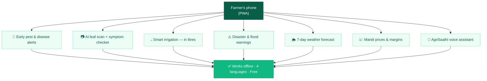
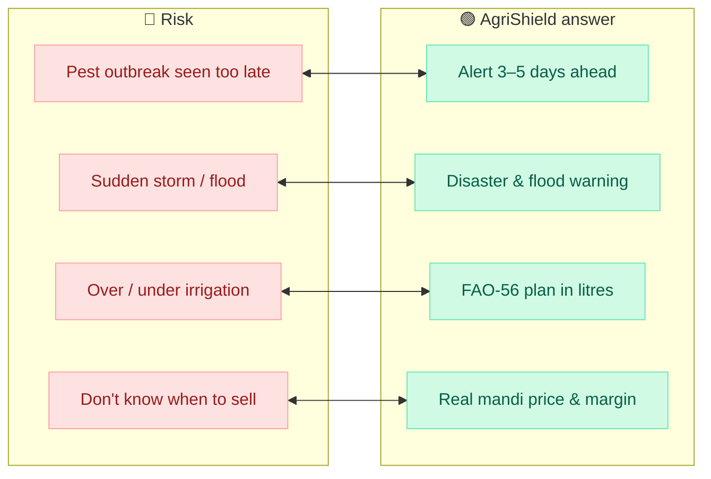
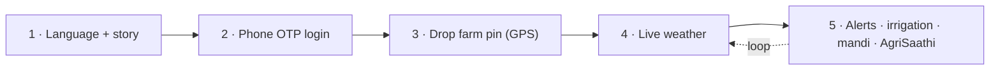
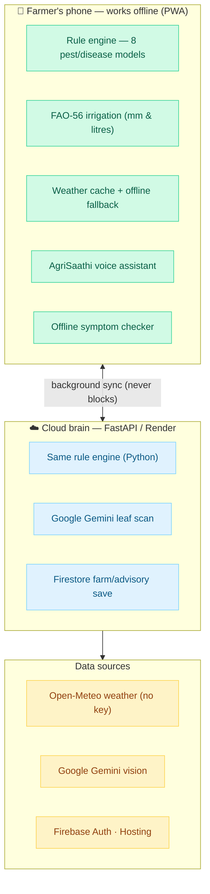
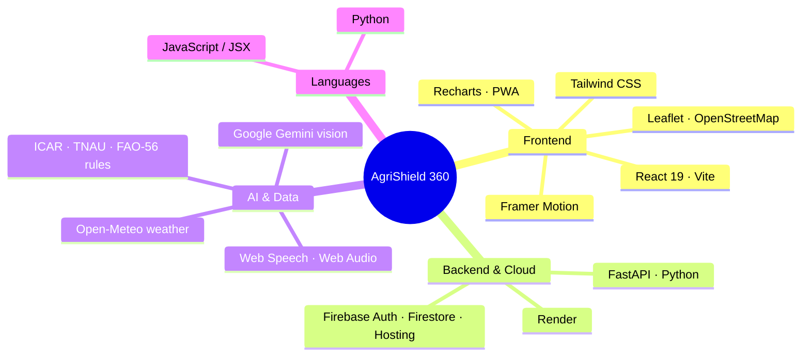
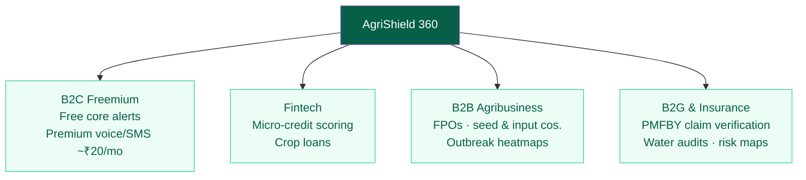
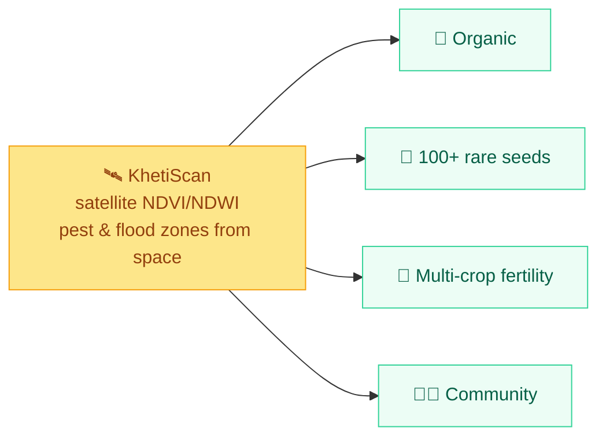
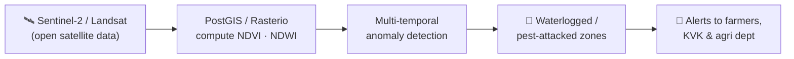

# 🛡️ AgriShield 365 — SIH 2026 SOFTWARE Deck · MASTER BUILD GUIDE

**The single source of truth for the software presentation.** Supersedes the earlier v1/v2
drafts. Build the entire deck from this file.

---

## 0. Quick facts (fill slide 1 from this)

| Field | Value |
|---|---|
| **Team** | RAVEN ROOTS (raven logo in every top-left oval) |
| **Problem Statement ID** | **SIH26131** |
| **PS Title** | Early detection and management of crop diseases and pest infestations |
| **Theme** | Agriculture, FoodTech & Rural Development |
| **Category** | **Software** |
| **Team ID** | `[FILL FROM SIH PORTAL]` |
| **Product** | **AgriShield 365** — *Every farmer, every season, protected.* |
| **Live app** | https://agrishield365.web.app |
| **Cloud API** | https://agrishield365-api.onrender.com |
| **Repo** | github.com/ramrounakmukherjee-blip/AgriShield365 |
| **Crops/regions** | Aman Paddy (Nadia/Burdwan/Hooghly WB) · Potato (Hooghly/Bankura WB) · Cotton (Nagpur/Yavatmal/Amravati/Washim — Vidarbha) |

**Hard rule:** the official deck is **FIXED at 6 slides** — never add a 7th. Slide 1 is a form-fill
title page and cannot carry content. Everything (video, future plans) folds INTO the six mandated
slides or lives in the linked report/video.

---

## 1. How to use this file & the two deliverables

We submit **one deck used two ways**:

- **LIVE pitch (.pptx, Sep 10–11 internal + any final):** Slide 2 plays an embedded **1:30
  product walkthrough video** (75% of the slide) beside a services flowchart (25%) — judges watch
  the product instead of reading bullets.
- **SIH uploaded PDF:** slide 2 **cannot embed video**, so it uses a static **pictorial hero**
  (problem→solution→services diagrams). The QR + an unlisted YouTube link are on both versions so a
  judge can still watch the full **8-min walkthrough** at their desk.

Every diagram below gives you **(a) a copy-paste Napkin AI prompt** and **(b) ready Mermaid code**
(paste into mermaid.live → light theme → export SVG). Use whichever looks better; they encode the
same content.

**Design rules for every diagram/slide:**
- One idea per diagram; **labels ≤ 5 words**; sentences stay in your mouth (speaker notes).
- Palette: SIH navy headings + our **emerald/green** brand; red only for "risk/before", gold only
  for the KhetiScan breakthrough.
- Flat modern cards, rounded corners, thin arrows, lots of white space.
- RAVEN ROOTS raven logo in the top-left oval; SIH 2026 bulb top-right; blue footer bar intact.

---

## 2. The story we tell (memorise this spine)

A smallholder farmer works all season and still loses the crop to a pest he saw three days too
late, or a storm the forecast predicted but never reached him. **AgriShield 365 turns his phone
into the adviser the village never had** — early pest/disease alerts grounded in ICAR/TNAU
thresholds, FAO-56 smart irrigation in litres, disaster warnings, real mandi prices, an AI leaf
scan and an offline voice assistant (**AgriSaathi**) — **in his language, working in airplane
mode, free, and live today**. Four differentiators: **dual-brain offline-first architecture**;
**story + voice onboarding for low literacy**; **zero-cost stack**; and a **live deployed product
with a QR judges can open mid-talk**.

---

# SLIDE 1 — TITLE PAGE (form-fill, fixed)

Fill the template blanks exactly:
- **Problem Statement ID —** `SIH26131`
- **Problem Statement Title —** Early detection and management of crop diseases and pest infestations
- **Theme —** Agriculture, FoodTech & Rural Development
- **PS Category —** Software
- **Team ID —** `[from portal]`
- **Team Name (registered) —** RAVEN ROOTS
- Replace the "Your Team Name" oval with the **raven logo**. Optional subtle corner line:
  `Solution: AgriShield 365 · agrishield365.web.app`.

**Speaker note (~20s):** *"Good morning — we are RAVEN ROOTS, on problem statement SIH26131,
early detection and management of crop diseases and pest infestations. Our product is AgriShield
365 — every farmer, every season, protected. It is live today; you can scan a QR on the next slide
and open it on your own phone right now."*

---

# SLIDE 2 — PROPOSED SOLUTION  (live = video hero · PDF = pictorial)

**IDEA TITLE:** AgriShield 365 — *Every Farmer, Every Season, Protected.*

### LIVE .pptx layout
- **Left 75% — embedded 1:30 walkthrough video** (autoplay on click). Golden path to record:
  cinematic story (with music + hold-to-pause) → language picker → phone OTP (`123456`) → map
  onboarding with farm pin → Home pest alert with **"Why this alert?"** open → JalRakshak mm/litres
  → Forecast chart → **AgriSaathi** sprout chat (ask a question + 🎤) → Crop Health (scan card +
  symptom checker) → Market with **real mandi price + margin**.
- **Right 25% —** services flowchart (**Diagram 1**) + QR code + three links:
  - 🌐 Live app: `agrishield365.web.app`
  - 📺 Full 8-min walkthrough (unlisted YouTube): `[PASTE LINK]`
  - 💻 Code + detailed report: GitHub repo + Google Docs report `[PASTE LINKS]`
- Footer: *SIH26131 · Early detection & management of crop diseases & pest infestations*.

### PDF layout (no video)
Three columns — left problem boxes, centre story painting, right solution — plus the Risk⇄Solution
strip (Diagram 3); put Diagram 2 ("loss→protection") big where the video would be. Keep QR +
YouTube link.

**Left problem boxes (PDF; the video already says this live):**
- **Real-world issue:** pests/disease & storms seen too late; advice not in his language, not
  offline, not on his phone.
- **Why it matters:** up to **40% of yield** lost to pests/disease (**CICR, Nagpur**); **3–5-day**
  IMD forecasts never reach the field; **~30% of irrigation water** wasted (**FAO-56**).
- **Solution:** one installable web app that warns early, quantifies irrigation in litres, scans
  leaves with AI, and answers by voice — grounded in verified science.

**Centre:** cinematic story painting (scene 6, daughter + phone) with the AgriSaathi sprout mascot.

**Right solution boxes (short labels):**
🐛 8 pest/disease models on live weather × crop stage · "Why this alert?" + action ·
📷 Crop Health: Gemini leaf scan + offline symptom checker ·
💧 JalRakshak: FAO-56 → exact mm & litres, skips rain days ·
⚠️ Disaster/flood + 7-day forecast · 📈 Real mandi price & margin ·
🤖 AgriSaathi offline voice assistant + coach tour ·
🌐 EN/हिन्दी/বাংলা/मराठी · 📶 offline PWA · stays signed in.

### 📊 DIAGRAM 1 — Services flowchart (right 25% column)
**Napkin AI prompt:**
> A clean vertical flow titled "AgriShield 365 — what the farmer gets". Top node "Farmer's phone
> (PWA)". Branch down to 7 short-label rounded cards with thin arrows: "Early pest & disease
> alerts", "AI leaf scan + symptom checker", "Smart irrigation — litres", "Disaster & flood
> warnings", "7-day weather forecast", "Mandi prices & margins", "AgriSaathi voice assistant".
> Bottom wide badge: "Works offline · 4 languages · Free". Emerald/green palette, navy title, flat
> modern, white space.

**Mermaid:**

### 📊 DIAGRAM 2 — "From loss to protection" hero (PDF slide-2 centre)
**Napkin AI prompt:**
> Wide left-to-right before/after infographic. LEFT (grey/red): worried farmer, pest-damaged leaf,
> storm cloud; label "Sees pests & storms too late — up to 40% of yield lost (CICR)". Bold arrow
> across the middle labelled "AgriShield 365". RIGHT (green): happy farmer with a phone showing
> alerts + sprout mascot; label "Warned 3–5 days early — in his language, offline". Under the arrow
> four chips: "Rule-engine pest alerts", "FAO-56 irrigation", "AgriSaathi AI assistant",
> "Mandi prices". Flat, emerald/navy.

### 📊 DIAGRAM 3 — Risk ⇄ Solution strip (bottom of slide 2)
**Napkin AI prompt:**
> Two-row comparison titled "From risk to readiness". Top red boxes "Farmer risks": "Pest outbreak
> seen too late", "Sudden storm / flood", "Over/under-irrigation", "Don't know when to sell".
> Double-headed arrows down to green boxes "AgriShield answer": "Early rule-engine alert 3–5 days
> ahead", "Disaster & flood warnings", "FAO-56 water plan in litres", "Real mandi price & margin".
> Red-vs-emerald, navy headings.

**Mermaid:**

**Speaker note (~75s):** *"Rather than read about it, watch ninety seconds of the real, deployed
app. [play] As you see, the farmer picks his language, logs in with an OTP, drops a pin on his
field, and starts getting pest alerts with the science behind each one, exact irrigation in
litres, storm warnings, real mandi prices, and an AI assistant he can talk to — all offline, in
four languages, free. Four things make us different: the advisory brain lives on the phone so
nothing ever hangs; it's built offline-first for real village connectivity; story and voice make
it usable without literacy; and it costs nothing — it's live right now, scan the QR."*

---

# SLIDE 3 — TECHNICAL APPROACH

Three panels: **left = farmer journey cycle**, **centre = two-brain architecture (most important)**,
**right = tech-stack mind-map + screenshots + QR**.

### 📊 DIAGRAM 4 — Farmer journey cycle (left)
**Napkin AI prompt:**
> Circular process, 5 coloured nodes clockwise, titled "Farmer journey". 1 (blue) "Choose language
> + story — onboarding for low literacy"; 2 (yellow) "Phone OTP login"; 3 (green) "Drop farm pin
> (GPS/map)"; 4 (orange) "Live weather fetched"; 5 (red) "Alerts · irrigation · mandi ·
> AgriSaathi". Sprout icon in centre; side callout "Stays signed in — no repeated login". Flat,
> bright, navy title.

**Mermaid:**

### 📊 DIAGRAM 5 — Two-brain, never-blocking architecture (centre; our flagship visual)
**Napkin AI prompt:**
> Architecture diagram titled "Two-brain, never-blocking design". LEFT: a smartphone "📱 PWA on the
> farmer's phone — works offline" containing stacked cards: "Rule engine (8 pest models)",
> "FAO-56 irrigation", "Weather cache", "AgriSaathi assistant", "Offline symptom checker". Dashed
> double-arrow to a RIGHT cloud "☁️ Cloud brain (FastAPI / Render)" containing "Same rule engine
> (Python)", "Gemini leaf scan", "Firestore save". Around the cloud three source chips:
> "Open-Meteo weather", "Google Gemini vision", "Firebase auth/hosting". Bold badge under the
> phone: "Phone computes first → cloud only enriches → never blocks the UI". Emerald phone, sky
> cloud, navy labels.

**Mermaid:**

### 📊 DIAGRAM 6 — Tech-stack mind-map (right)
**Napkin AI prompt:**
> Mind-map, central node "AgriShield 365", four pill branches: "Frontend" (React 19, Vite, Tailwind
> CSS, Framer Motion, Leaflet/OpenStreetMap, Recharts, PWA/Workbox); "Languages" (JavaScript/JSX,
> Python); "Backend & Cloud" (FastAPI, Render, Firebase Auth/Firestore/Hosting); "AI & data"
> (Google Gemini vision, Open-Meteo, Web Speech API, Web Audio API, ICAR/TNAU/FAO-56 rules). Dashed
> connectors, emerald/navy.

**Mermaid:**

**Right-bottom:** 3 real screenshots — (1) pest alert with "Why?" open, (2) JalRakshak mm/litres,
(3) AgriSaathi sprout chat — plus **QR "Scan to open the live app"**.

**Speaker note (~75s):** *"The flow starts with the farmer — language, OTP, a pin on his actual
field. We pull a 7-day and 24-hour forecast for that GPS from Open-Meteo, free, no key. The heart
is our rule engine: eight pest and disease models check temperature, humidity, rain and crop stage
against thresholds compiled from ICAR, CICR Nagpur and TNAU. Irrigation uses FAO-56 — crop
coefficient times reference evapotranspiration — so we say millimetres and litres and skip rainy
days. Everything reaches him by voice, WhatsApp share, or AgriSaathi. On the cloud, FastAPI runs
the same engine in Python and Gemini handles leaf photos — but the phone computes first, so the
cloud never blocks him. This is the real product — please scan the QR."*

---

# SLIDE 4 — FEASIBILITY, VIABILITY & BUSINESS MODEL

Three pinned cork-board panels (Lanezy style): **Feasibility Analysis** · **Viability** ·
**Business Potential**; add a small Challenges→Strategies strip, then the revenue tree.

**Feasibility panel (★★★★½):**
- ♻️ Reuses free infrastructure (Firebase Spark, Render free, keyless Open-Meteo) → **~₹0 running cost**
- 📈 Scalable — thresholds live in a JSON rules file; **new crops = data, not code**
- 💲 Cost-effective — PWA, no app store, installs from a link, tiny data footprint
- 👥 Authority-ready — real phone OTP auth, Firestore, cloud API

**Viability panel:**
- 🔍 Proven concept — local-first architecture already deployed & device-tested
- 🤝 Builds public trust — alerts cite ICAR/TNAU/FAO + "confirm with your KVK officer"
- 📋 Accountability — every advisory logged locally + in cloud history
- 🏛️ Engagement — AgriSaathi coach tour + voice for low-literacy users

**Challenges → strategies strip:**
- Patchy village internet → **offline-first PWA**, cloud only enriches
- SMS needs billing (Spark blocks) → whitelisted test OTP now; **Blaze upgrade is a config flip**
- Cloud AI quota/cost → local engine + offline symptom checker **never depend on Gemini**; scan = premium tier
- Low digital literacy → cinematic story, 4 languages, voice read-aloud + voice questions
- Advice trust → ICAR/TNAU/FAO grounding + KVK disclaimer

### 📊 DIAGRAM 7 — Sustainable business-model tree (service/freemium for software)
**Napkin AI prompt:**
> Hierarchy chart titled "Sustainable business model". Top node "AgriShield 360". Four pillars as
> wide rounded cards with 2–3 bullets each: "B2C Freemium — free core alerts & risk scores; premium
> voice/SMS alerts ~₹20/month"; "Fintech partners — micro-credit scoring & crop loans from farm
> advisory history"; "B2B Agribusiness — FPOs & seed/fertilizer cos.; anonymized disease-outbreak
> heatmaps to pre-position bio-fungicides/inputs"; "B2G & crop insurance — PM Fasal Bima Yojana
> (PMFBY) claim verification, water audits, government risk mapping". Emerald/navy tree.

**Mermaid:**

**Distribution footnote:** deploys today at zero cost → spread via **KVKs, state agriculture
departments and krishi WhatsApp groups** (no app store / marketing needed).

**Speaker note (~70s):** *"Feasibility is a design requirement, not an afterthought. It's already
built and runs on free tiers at near-zero cost; adding crops means editing a rules file. The big
risk — village connectivity — is why the whole advisory works in airplane mode, and AI quota can
never break it because our pest logic runs locally. Trust comes from ICAR/TNAU/FAO grounding and
always pointing back to the KVK officer. On sustainability, the core app stays free for farmers;
revenue comes from premium voice alerts at twenty rupees a month, agribusiness partnerships that
route inputs to outbreak zones, and government — notably Fasal Bima insurance verification and water
audits."*

---

# SLIDE 5 — IMPACT & BENEFITS  (+ KhetiScan teaser band)

**Layout:** impact wheel (left) · crisis-vs-AgriShield bar chart (right) · Social/Economic/
Environmental chevrons + beneficiary strip (middle) · **gold KhetiScan teaser band across the
bottom**.

### 📊 DIAGRAM 8 — Impact wheel (left)
**Napkin AI prompt:**
> Circular impact diagram; centre circle split "IMPACTS | BENEFITS" with a sprout icon; 4 numbered
> ring nodes, each a heading + one line: 1 "Yield protected — up to 40% loss avoided (CICR)";
> 2 "Early warning — 3–5 day disaster lead time (IMD/TNAU)"; 3 "Water saved — ~30% via FAO-56 timed
> irrigation"; 4 "Income & inclusion — mandi margins; voice in 4 languages for low-literacy & women
> farmers". Soft green/gold, navy text.

### 📊 DIAGRAM 9 — "Crisis today vs with AgriShield" bars (right)
**Napkin AI prompt:**
> Horizontal bar chart titled "What early warnings change". Each category two bars (grey = today,
> green = with AgriShield 365): "Pest yield loss: 40% → under 10%"; "Irrigation water wasted: 30%
> → under 8%"; "Storm/flood lead time: 0–1 day → 3–5 days"; "Farmers getting advisory in local
> language: under 10% → 100%". Grey-vs-emerald; caption "Estimates grounded in CICR, FAO-56,
> IMD/TNAU".

**Chevron chain:** 🔵 **Social** — inclusive voice/language, disaster safety → 🟣 **Economic** —
yield protected, input costs cut, better mandi price → 🟢 **Environmental** — threshold-based
spraying cuts chemicals; timed irrigation saves water.

**Beneficiary strip:** 👨‍🌾 smallholder farmers · 🏥 KVK/extension workers · 🏛️ state agriculture dept.

**Big-number banner (optional across top):** **40% yield protected · 3–5 day early warning · 30%
water saved.**

### 📊 DIAGRAM 12 — "Future: KhetiScan" gold teaser band (bottom; SHORT hook only)
Keep it ~15% of slide height. Do **not** explain the module on the slide — full detail lives in the
report/video.

**Napkin AI prompt:**
> Slim horizontal "future vision" banner, gold & emerald. Left: a small satellite icon over farm
> fields with a gold star badge "Breakthrough". Middle short text: "KhetiScan — geospatial canopy
> surveillance: satellite NDVI/NDWI (Sentinel-2/Landsat) spots pest-attacked & waterlogged zones
> across whole districts before field visits." Right: four tiny icon chips: "Organic farming",
> "100+ rare paddy seeds", "Multi-crop fertility", "Farmer community". Compact, flat.

**Mermaid (compact):**

**One-line slide text:** *"And beyond the phone: KhetiScan will watch entire districts from open
satellite data — catching pest and flood zones from space."*

**Speaker note (~60s):** *"Impact hits three groups at once. Farmers protect up to forty percent of
yield and about thirty percent of their water; extension workers carry one verified card to
hundreds; government gets a near-zero-cost advisory channel that also yields regional pest data.
Socially inclusive through voice and language; economically it protects yield and cuts cost;
environmentally it means spraying and irrigating only when thresholds are crossed. And this is one
phone — the gold band is our leap: KhetiScan watches whole districts from open satellite data. I
won't unpack it here; there's a full module in our report and video — but it turns one farmer's
alert into a regional early-warning map."*

---

# SLIDE 6 — RESEARCH & REFERENCES  (squeezed) + links

Keep sources tight — a compact **hexagon chain** across the top (small hexes, name only; full URLs
in the report):

**ICAR – CICR Nagpur** → **TNAU Agritech Portal** → **FAO-56 Paper 56** → **IMD Agromet** →
**Agmarknet** → **Open-Meteo** → **Copernicus Sentinel-2/Landsat** *(last doubles as the future
KhetiScan data source)*.

**Bottom link panel — "Try it & read more":**
- 📱 Live app QR → agrishield365.web.app
- ☁️ API status: agrishield365-api.onrender.com/health
- 💻 GitHub repo
- 📺 Unlisted YouTube 8-min walkthrough `[PASTE LINK]`
- 📄 Full Google-Docs report (complete KhetiScan module, business model, roadmap) `[PASTE LINK]`

**"What's next" footer (one line):**
> 🛰️ **Next: KhetiScan** — district-wide pest & flood detection from open satellite data · organic
> farming · 100+ rare paddy seeds · full roadmap in the report.

**Speaker note (~25s):** *"Every threshold traces to a verifiable source — ICAR's cotton institute,
TNAU, the FAO irrigation standard, the meteorological department — and our future KhetiScan module
uses the EU's open Sentinel satellites. It's all live now; the QR opens it on your phone, and a full
written report and eight-minute video are linked. Thank you — RAVEN ROOTS, ready for your
questions."*

---

# 3. FUTURE PLANS — REPORT & VIDEO ONLY (never a 7th slide)

KhetiScan gets only the slide-5 teaser band + slide-6 footer. The full breakdown goes in the Google
Docs report and 8-min video (no slide limit there).

### ⭐ KhetiScan — Geospatial Canopy Surveillance (report detail)
The module that scales AgriShield from one phone to a regional early-warning system:
- **Technology:** **Copernicus Sentinel-2 / Landsat open satellite data** via PostGIS / Rasterio.
- **Detection:** **NDVI** = (NIR−Red)/(NIR+Red) and **NDWI** (vegetation & water indices) per field.
- **Anomaly detection:** flags sudden multi-temporal index drops across sectors — pinpointing
  **waterlogged or pest-attacked zones before any field visit**, then pushes alerts.
- **Why it's a leap:** today we warn one farm from weather; KhetiScan watches **whole districts from
  space** and routes teams to the exact infected sector.

### 📊 DIAGRAM 10 — Roadmap winding-road (report; optional tiny on slide-6 footer)
**Napkin AI prompt:**
> Winding road timeline, numbered milestones 01–08, "From one phone to every field": 01 Pilot
> paddy/potato/cotton (WB & Vidarbha); 02 all districts via rules file; 03 real SMS + push (Blaze);
> 04 live Agmarknet mandi feed; 05 (bigger, gold) KhetiScan satellite NDVI/NDWI; 06 organic farming
> + 100+ rare paddy seeds; 07 multi-crop soil-fertility advisor; 08 farmer community + 22 languages
> + KVK dashboards. Green road, gold breakthrough milestone.

**Mermaid:**

```mermaid
flowchart LR
    M1["01 Pilot<br/>3 crops"] --> M2["02 All districts"] --> M3["03 Real SMS/push"]
    M3 --> M4["04 Live mandi feed"] --> M5["⭐ 05 KhetiScan<br/>satellite NDVI/NDWI"]
    M5 --> M6["06 Organic + 100 rare seeds"] --> M7["07 Multi-crop fertility"]
    M7 --> M8["08 Community · 22 languages · KVK"]
    classDef star fill:#fde68a,color:#92400e,stroke:#f59e0b;
    classDef std fill:#ecfdf5,color:#065f46,stroke:#34d399;
    class M5 star; class M1,M2,M3,M4,M6,M7,M8 std;
```

### 📊 DIAGRAM 11 — KhetiScan science flow (report)

**Other future pillars (report cards):** 🌿 organic/natural farming guidance · 🌾 protect **100+ rare
paddy seed varieties** (heritage-seed library + advisory) · 🔁 multi-cropping & soil-fertility
advisor (suggest crops that improve land health) · 👨‍🌾 farmer community (share advisories, outbreak
reports, mandi tips — fed by the KhetiScan map).

---

# 4. Assets & prep checklist

**To record / create:**
- [ ] **1:30 golden-path walkthrough video** (embed in live slide 2)
- [ ] **~8-min unlisted YouTube** full walkthrough (you narrating part-by-part) → link on slides 2 & 6
- [ ] **Google Docs detailed report** (KhetiScan full chapter + everything that didn't fit) → slide 6
- [ ] **QR code PNG** → https://agrishield365.web.app (free generator)

**Screenshot shot-list** (Incognito, mobile width F12):
1. Cinematic story (scene 6 or a rain-FX scene)  2. OTP screen (demo-code note)  3. Onboarding map pin
4. **Home pest alert with "Why this alert?" open**  5. **JalRakshak mm + litres**  6. Forecast 7-day chart
7. **AgriSaathi sprout chat with an answer + chips**  8. Crop Health section (scan + symptom checker)
9. Market screen with **real mandi price + margin**

**Diagram build order (Napkin/Mermaid):** D1 services (s2) · D2 PDF hero (s2) · D3 risk⇄solution (s2) ·
D4 journey (s3) · **D5 two-brain architecture (s3, flagship)** · D6 tech stack (s3) · D7 revenue tree
(s4) · D8 impact wheel (s5) · D9 comparison bars (s5) · D12 KhetiScan teaser (s5) · D10 roadmap +
D11 KhetiScan flow (report only).

**Demo-day checklist:**
- [ ] 10 min before: open https://agrishield365-api.onrender.com/health (wakes the cloud brain)
- [ ] Phone: PWA installed + logged in; know **Profile → Sign out → OTP 123456** for a fresh demo
- [ ] Keep the **2–3 min golden-path video** as a backup in case venue internet hiccups
- [ ] Mobile hotspot ready
- [ ] Practice the six speaker scripts aloud; assign one slide per teammate
- [ ] RAVEN ROOTS raven logo in every top-left oval

**Always exactly 6 slides.** KhetiScan full detail, roadmap and deep-dives live only in the report +
video, linked by QR.
