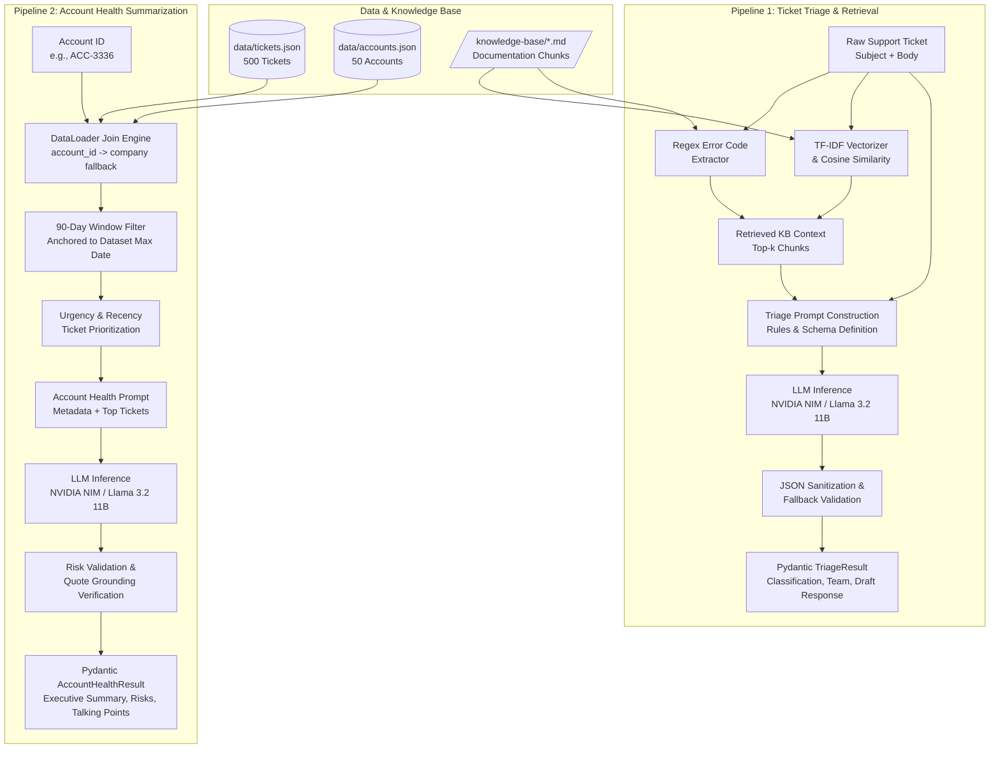

# AI Product Support Agent

> **An enterprise product support system featuring automated ticket triage, TF-IDF knowledge retrieval, Technical Account Manager (TAM) health summarization, and an automated evaluation harness.**

---

### System Highlights at a Glance

| Dimension | Implementation Details |
|---|---|
| **Core Workflows** | 1) Automated multi-class support ticket triage & response drafting<br>2) 90-day account health summarization, verbatim quote extraction & TAM talking points |
| **Model & Inference** | `meta/llama-3.2-11b-vision-instruct` hosted via NVIDIA NIM (OpenAI SDK client wrapper) with exponential backoff retries |
| **Structured Output** | Strict Pydantic v2 schemas with field-level enum validators and defensive normalization fallbacks |
| **Retrieval Engine** | Sub-linear n-gram TF-IDF cosine similarity + regex error code runbook matcher (zero vector DB overhead) |
| **Data Resiliency** | Multi-strategy join (account ID with fallback to company name) & anchored dataset temporal window (`2026-05-22`) |
| **Verified Test Suite** | 15 automated evaluation tests across standard & adversarial scenarios (**100% pass rate**, **0.96 / 1.00 avg score**) |
| **Assessment Context** | Developed as a portfolio-ready technical assessment submission for an enterprise AI Engineering role |

---

## Overview

The **AI Product Support Agent** is a portfolio-ready, production-oriented Python system designed to streamline customer support and technical account management for enterprise SaaS platforms. It automates two critical workflows:

1. **Intelligent Ticket Triage & Response Drafting**: Automatically parses incoming support tickets, extracts technical error codes, retrieves relevant documentation from a local knowledge base, determines product classification and urgency, routes the issue to the appropriate engineering team, and drafts a grounded customer response.
2. **Account Health & Churn Risk Summarization**: Analyzes customer metadata alongside recent support interactions to generate executive summaries, extract verbatim risk quotes, compute churn risk levels, and produce actionable talking points for Technical Account Managers (TAMs).

*Assessment Disclosure*: This repository was originally developed as part of a technical assessment for an AI Engineering role, demonstrating end-to-end LLM application design, defensive data modeling, retrieval architecture, and automated evaluation.

---

## Key Features

- **Multi-Class Ticket Triage**: Accurately classifies support tickets across 5 SaaS products, specific sub-modules, 8 issue categories (`Bug`, `Feature Request`, `How-To`, `Performance`, `Billing`, `Integration`, `Onboarding`, `Data Loss`), and 4 urgency tiers (`P1`–`P4`).
- **TF-IDF Knowledge Base Retrieval**: Indexes markdown documentation chunks with scikit-learn TF-IDF vectorization and direct regex-based error code matching (`ERR_CONNECTION_TIMEOUT`, `SCHEMA_MISMATCH`, etc.) without requiring external vector database infrastructure.
- **TAM Account Health Insights**: Synthesizes 90 days of support tickets and account telemetry into a structured executive brief with verbatim quote-grounded risk items and churn risk scoring (`Low`, `Medium`, `High`).
- **Resilient Data Join Strategy**: Gracefully handles real-world data inconsistencies, including synthetic tickets lacking direct `account_id` foreign keys (falling back to company name matching) and anchoring the 90-day analysis window to dataset reference dates.
- **Strict Structured Outputs**: Utilizes Pydantic v2 models and JSON schema constraints with defensive post-processing fallbacks to prevent schema breakage.
- **Automated 15-Test Evaluation Suite**: Measures classification precision, response quality, quote verification, determinism, and adversarial edge cases (gibberish inputs, missing accounts).

---

## Architecture

The system is decoupled into two primary processing pipelines sharing a unified configuration, data loading layer, retrieval engine, and LLM wrapper:



---

## Tech Stack

| Component | Technology | Purpose |
|---|---|---|
| **Language** | Python 3.10+ | Core application runtime |
| **LLM Inference** | NVIDIA NIM / OpenAI SDK | Hosted inference for `meta/llama-3.2-11b-vision-instruct` |
| **Structured Output** | Pydantic v2 | Data validation, type enforcement, and schema generation |
| **Retrieval Engine** | scikit-learn (`TfidfVectorizer`) | Lexical/n-gram retrieval and cosine similarity matching |
| **Configuration** | python-dotenv | Environment variable and API key management |
| **CLI & Formatting** | argparse / rich | Command line interface and formatted terminal outputs |

---

## Project Structure

```
.
├── config.py                  # Global settings, routing tables, and valid taxonomies
├── main.py                    # Unified CLI entrypoint (triage, health, evaluate)
├── requirements.txt           # Python package dependencies
├── .env.example               # Environment template for API credentials
├── DATA_SCHEMA.md             # Dataset documentation and schema definitions
├── design_note.md             # System design note: failure modes, latency, scaling
├── eval_report.md             # Generated evaluation report with full test matrix
│
├── src/                       # Core application source code
│   ├── __init__.py
│   ├── models.py              # Pydantic v2 input/output data models & validators
│   ├── llm_client.py          # OpenAI/NVIDIA NIM client wrapper with backoff retries
│   ├── kb_retriever.py        # TF-IDF indexer, chunker, and error-code matcher
│   ├── data_loader.py         # Multi-strategy data joiner and temporal filter
│   ├── triage_agent.py        # Ticket classification and draft response agent
│   └── account_health.py      # TAM health summary and churn risk engine
│
├── data/                      # Synthetic enterprise dataset
│   ├── tickets.json           # 500 support tickets with categories and urgencies
│   └── accounts.json          # 50 customer accounts with ARR, health, and notes
│
├── knowledge-base/            # Modular product documentation corpus
│   ├── products/              # Product specs (DataBridge Pro, CloudSync, etc.)
│   ├── troubleshooting/       # Authentication/SSO and performance runbooks
│   ├── billing/               # Plan tiers, seat limits, and invoice FAQs
│   └── onboarding/            # Setup guides and provisioning instructions
│
└── evaluation/                # Automated evaluation framework
    ├── harness.py             # Test runner executing the complete eval suite
    ├── test_triage.py         # 8 standard and adversarial triage test cases
    ├── test_account_health.py # 7 account health quality and determinism tests
    └── report.py              # Markdown report generator with quality scoring
```

---

## How It Works

### 1. Support Ticket Triage (`src/triage_agent.py`)
1. **Query Construction**: Concatenates ticket subject and body into a search query.
2. **Context Retrieval**: Queries the TF-IDF index for top-3 relevant documentation chunks (`min_similarity=0.05`). Simultaneously extracts uppercase error codes (`ERR_...`, `SCHEMA_...`) to append exact runbook sections.
3. **Prompt Compilation**: Assembles the taxonomy rules (5 products, corresponding product areas, 8 categories, 4 urgency levels, team routing tables) and retrieved KB text into a structured system prompt.
4. **LLM Inference**: Calls the model using JSON output constraints at temperature `0.0` and seed `42`.
5. **Defensive Post-Processing**: Validates the output against `config.py` enums. If the LLM generates slight casing or naming variations, fallback substring matching normalizes the value before constructing the final `TriageResult`.

### 2. Knowledge Base Retrieval (`src/kb_retriever.py`)
- **Indexing & Chunking**: Parses markdown files in `knowledge-base/` split on `\n---\n` section delimiters. Preserves headers (`#`, `##`) and product tags as chunk metadata.
- **TF-IDF Search**: Computes sub-linear TF-IDF vectors using unigrams and bigrams (`ngram_range=(1, 2)`). Cosine similarity measures query-to-chunk relevance.
- **Error Code Lookup**: Direct substring scan across chunk contents to guarantee that documented error codes are retrieved regardless of vocabulary overlap.

### 3. Account Health Summarization (`src/account_health.py`)
1. **Account Lookup**: Loads target account metadata from `data/accounts.json`.
2. **Temporal Join**: Queries `data/tickets.json` for tickets belonging to the account within the last 90 days. If `account_id` matching yields zero tickets, the loader joins via the account's `company` name. The 90-day window is anchored to the latest ticket timestamp in the dataset (`2026-05-22`).
3. **Ticket Prioritization**: Sorts tickets by urgency (`P1` > `P2` > `P3` > `P4`) and recency, capping the prompt context at the top 20 tickets.
4. **LLM Summarization**: Generates a 3–5 sentence executive brief, extracts open risks with mandatory verbatim quotes, identifies 3–5 TAM talking points, and assesses churn risk level.
5. **Validation**: Enforces `RiskItem` severity levels and returns `AccountHealthResult`.

### 4. Evaluation Harness (`evaluation/`)
- Evaluates functional correctness, schema validity, and edge-case resilience across 15 automated test cases without human-in-the-loop intervention.
- Scored deterministically using normalized quality criteria (`0.0` to `1.0`).

---

## Retrieval Implementation & Tradeoffs

The system uses **TF-IDF (Term Frequency–Inverse Document Frequency) retrieval** with n-gram tokenization and cosine similarity over markdown documentation chunks.

### Why TF-IDF was Chosen
- **Zero Heavy Infrastructure**: Eliminates the need for external vector databases (Pinecone, Qdrant, Milvus) or local C-extension dependencies (Chroma, Faiss), keeping the setup lightweight and reproducible.
- **Deterministic & Fast**: Sub-millisecond similarity scoring across 50+ technical documentation chunks.
- **Exact Keyword Sensitivity**: Technical error codes, product names, and protocol acronyms (`ERR_CONNECTION_TIMEOUT`, `SAML_ASSERTION_EXPIRED`) match precisely without embedding dilution.

### Limitations
- **Vocabulary Mismatch**: Queries using synonyms or colloquial phrasing with no keyword overlap with the documentation may receive low similarity scores.
- **Corpus Scale**: While suitable for hundreds of documentation sections, scaling to tens of thousands of documents requires hierarchical indexing or dense embedding representations.

---

## AI / LLM Design & Guardrails

- **Inference Client**: Custom wrapper around `openai.OpenAI` pointing to NVIDIA NIM endpoints.
- **Deterministic Sampling**: Standardized on `temperature=0.0` and `seed=42` to ensure reproducible triage classifications and health evaluations.
- **Resilience & Retries**: Implements a 3-attempt exponential backoff loop for transient API rate limits (HTTP 429) or connection timeouts.
- **Output Sanitization**: Strips accidental markdown code fences (```` ```json ````) before deserialization and handles malformed JSON payloads.
- **Schema Validation**: All outputs are strictly parsed into Pydantic models with field-level validators.

---

## Existing Evaluation Report (eval_report.md)

The metrics below are from the authoritative evaluation report (`eval_report.md` / `output/evaluation_report.md`) covering 15 automated test cases across both core pipelines:

### Overall Performance

| Metric | Recorded Value |
|---|---|
| **Total Tests** | 15 |
| **Passed** | 15 |
| **Failed** | 0 |
| **Pass Rate** | **100.0%** |
| **Average Quality Score** | **0.96 / 1.00** |

---

### Task 1: Ticket Triage Tests (8/8 Passed, Avg Score: 0.98)

| # | Test Name | Scenario Type | Result | Score | Criteria Evaluated |
|---|---|---|---|---|---|
| 1 | `test_clear_p1_bug` | Standard | PASS | 0.88 | Product match, category match, urgency within 1 level, reasoning length, response draft |
| 2 | `test_feature_request` | Standard | PASS | 1.00 | Exact classification on feature request with seat scaling context |
| 3 | `test_sso_error` | Standard | PASS | 1.00 | Error code matching (`SAML_ASSERTION_EXPIRED`) and SecureVault routing |
| 4 | `test_billing_inquiry` | Standard | PASS | 1.00 | Discrepancy detection in seat licensing vs. active user billing |
| 5 | `test_onboarding_new_org` | Standard | PASS | 1.00 | Multi-step onboarding and Azure AD SSO provisioning |
| 6 | `test_performance_issue` | Standard | PASS | 1.00 | Analytics query timeout and widget load latency triage |
| 7 | `test_adversarial_ambiguous` | Adversarial | PASS | 1.00 | Multi-issue ticket handling with primary issue selection |
| 8 | `test_adversarial_gibberish` | Adversarial | PASS | 1.00 | Graceful handling of unparseable/nonsense ticket text without crashing |

---

### Task 2: Account Health Tests (7/7 Passed, Avg Score: 0.94)

| # | Test Name | Scenario Type | Result | Score | Criteria Evaluated |
|---|---|---|---|---|---|
| 1 | `test_healthy_account` | Standard | PASS | 1.00 | Executive summary length, quote grounding, low churn classification |
| 2 | `test_at_risk_with_escalation`| Standard | PASS | 1.00 | Escalation note risk extraction and medium/high risk scoring |
| 3 | `test_churning_account` | Standard | PASS | 1.00 | Cancellation signal detection and high churn classification |
| 4 | `test_new_account` | Standard | PASS | 0.80 | New customer onboarding summary with 0 historical tickets |
| 5 | `test_determinism` | Standard | PASS | 1.00 | Consistent output across repeated runs on identical account data |
| 6 | `test_adversarial_nonexistent` | Adversarial | PASS | 1.00 | Graceful `ValueError` handling for non-existent account ID (`ACC-0000`) |
| 7 | `test_at_risk_high_arr` | Standard | PASS | 0.80 | High-value account ($240k ARR) churn risk synthesis |

---

## Engineering Tradeoffs & Scalability Considerations

1. **TF-IDF Lexical Retrieval vs. Dense Embedding Vectors**:
   - *Decision*: Adopted TF-IDF n-gram scoring with error code regex matching.
   - *Rationale*: For a ~50-chunk technical support runbook, exact keyword and error code matching provides zero latency overhead and eliminates embedding API costs and vector DB maintenance.
2. **Context Budgeting vs. Full History**:
   - *Decision*: Capped ticket analysis at the top 20 most urgent/recent tickets.
   - *Rationale*: Enterprise accounts can accumulate hundreds of historical tickets. Passing all tickets exceeds LLM context windows and increases latency without improving TAM summary relevance.
3. **Data Join Fallback Mechanism**:
   - *Decision*: Implemented `account_id` matching with fallback to `company` name string matching.
   - *Rationale*: Resolves real-world relational data gaps where legacy ticket ingestion pipelines failed to populate account foreign keys.
4. **Scalability Considerations (Design Analysis)**:
   - *Consideration*: As analyzed in `design_note.md`, handling 10x ticket volume (5,000+ tickets) would require transitioning from sequential processing to an asynchronous worker queue with rate-limit semaphores and pre-aggregation ticket summarization. This is documented as an architectural scaling path rather than an existing benchmark.

---

## Limitations

- **Synthetic Data**: The datasets in `data/` are synthetically generated.
- **Lexical Retrieval Bounds**: Conceptual queries without token overlap with the knowledge base rely primarily on LLM parametric knowledge.
- **Synchronous CLI Execution**: CLI commands run synchronously; batch processing large volumes of tickets sequentially is bounded by single-thread LLM latency.

---

## Installation

### Prerequisites
- Python 3.10 or higher
- NVIDIA NIM API Key (or OpenAI-compatible API endpoint)

### Setup

1. **Clone the repository**:
   ```bash
   git clone https://github.com/your-username/ai-product-support-agent.git
   cd ai-product-support-agent
   ```

2. **Create and activate a virtual environment**:
   ```bash
   python -m venv .venv
   # On macOS/Linux:
   source .venv/bin/activate
   # On Windows (PowerShell):
   .venv\Scripts\Activate.ps1
   ```

3. **Install dependencies**:
   ```bash
   pip install -r requirements.txt
   ```

4. **Configure environment variables**:
   ```bash
   cp .env.example .env
   ```
   Open `.env` and configure your API key:
   ```env
   NVIDIA_API_KEY=your_nvidia_api_key_here
   NIM_MODEL=meta/llama-3.2-11b-vision-instruct
   ```

---

## Usage

The application provides a unified command line interface via `main.py`:

### 1. Support Ticket Triage
Triage an incoming support ticket, match knowledge-base articles, route to the appropriate engineering team, and draft a response:

```bash
python main.py triage --subject "Pipeline down" --body "Our DataBridge Pro pipeline stopped processing. Error: ERR_CONNECTION_TIMEOUT after 30s."
```

### 2. TAM Account Health Summary
Generate a Technical Account Manager summary for a specific customer account:

```bash
python main.py health --account-id ACC-3336
```

### 3. Automated Evaluation Suite
Run the full 15-test evaluation harness and regenerate the markdown evaluation report:

```bash
python main.py evaluate
```
*Output report will be saved to `output/evaluation_report.md` and synced with `eval_report.md`.*

---

## Example Output

### Ticket Triage Output (`python main.py triage ...`)
```json
{
  "predicted_product": "DataBridge Pro",
  "predicted_product_area": "Connectors",
  "predicted_category": "Bug",
  "predicted_urgency": "P2",
  "reasoning": "The customer is reporting connection timeouts in their DataBridge Pro Connectors pipeline, impacting multiple active users.",
  "matches_known_issue": true,
  "known_issue_summary": "ERR_CONNECTION_TIMEOUT occurs when the connector gateway exceeds the 30s threshold under heavy connection pooling.",
  "relevant_kb_articles": [
    "DataBridge Pro Overview and Error Codes",
    "Performance and Connection Troubleshooting"
  ],
  "recommended_team": "Data Platform Team",
  "draft_response": "Hello,\n\nThank you for reaching out to support. We understand your DataBridge Pro Connectors pipeline is experiencing ERR_CONNECTION_TIMEOUT issues. Please verify network egress rules on port 443 and verify connector pool limits as outlined in our troubleshooting runbook. Our Data Platform Team is reviewing the diagnostic logs.\n\nBest regards,\nProduct Support Team"
}
```

---

## Future Improvements

The following architectural enhancements are planned for production deployment:

- **Dense Embedding & Hybrid Search**: Introduce dense vector representations (e.g. `text-embedding-3-small` / BGE) combined with BM25 keyword search and cross-encoder reranking.
- **REST / FastAPI Interface**: Expose asynchronous endpoints for integration into Zendesk, Jira Service Management, and Salesforce Service Cloud.
- **PII Scrubbing Middleware**: Implement client-side Named Entity Recognition (NER) / regex masking to redact emails, phone numbers, and API tokens before transmitting prompts to external LLMs.
- **Asynchronous Batch Processing**: Add Celery / Redis queue workers with semaphore rate-limiting for high-throughput batch ticket processing.
- **Observability & Tracing**: Integrate OpenTelemetry and Langfuse / Phoenix to monitor token usage, retrieval similarity distributions, and LLM latency in real time.

---

## Assessment Context

This project was developed to address a comprehensive AI Engineering technical task. It illustrates core competencies in:
- Designing modular LLM applications with strict schema enforcement (Pydantic v2).
- Building fast, dependency-lean retrieval systems (TF-IDF + Error Code Indexing).
- Handling real-world data discrepancies (multi-key join fallback, temporal window anchoring).
- Establishing automated, quantitative evaluation frameworks for LLM applications.
